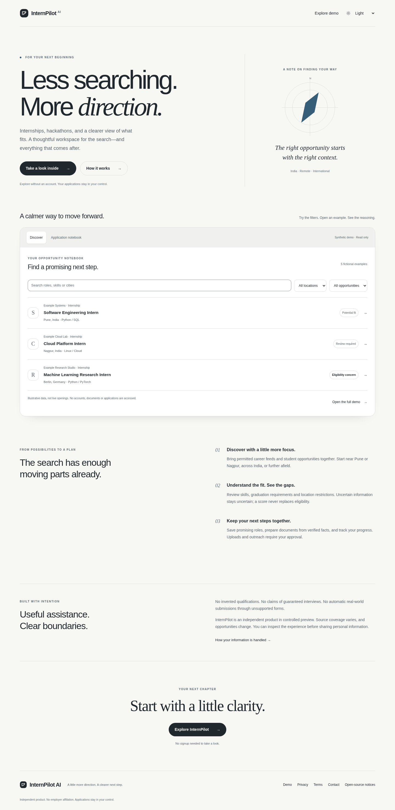
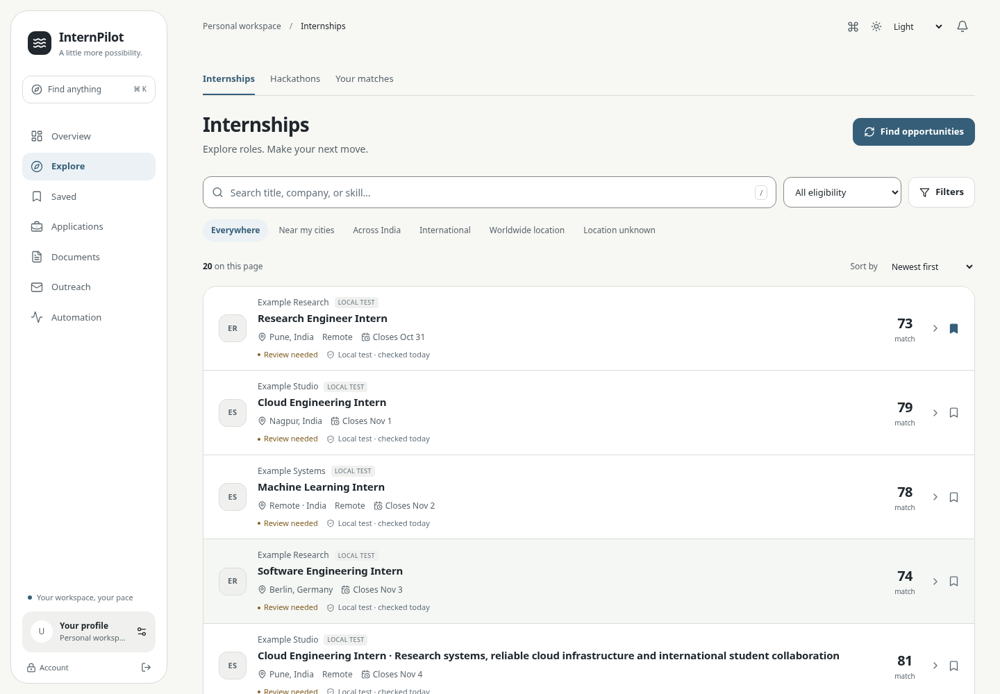
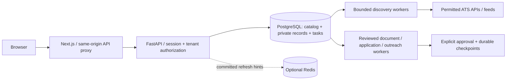

# InternPilot AI

**Latest founder/security release:** [secure first-run login, MFA, recovery, migration and verification](docs/FOUNDER_SECURITY.md). On Windows with Docker Desktop running, double-click `scripts/run_local.bat`. It starts the complete stack and prompts for your founder email/password if none exists. There is no hardcoded master credential. Existing accounts, keys and database volumes are preserved; see the guide before upgrading multiple legacy owner accounts.

An India-first internship and hackathon discovery workspace built with Next.js, FastAPI and PostgreSQL. It combines explainable eligibility checks, a shared opportunity catalog, durable background tasks, factual PDF documents and review-based application/outreach workflows.

**[Explore the public preview](https://internpilot-ai-notebook.antigravityfree101.chatgpt.site)** — a deployed, read-only product introduction with explicitly fictional examples, no signup and no private data. [Launch evidence and limitations](docs/PHASE9_LAUNCH.md).

**Full workspace status: engineering release candidate for controlled evaluation.** The public preview does not host FastAPI, PostgreSQL, registration or background workers. External final application submission is supported only by the authorized local test adapter. Real employer workflows remain assisted/manual. [Security review](docs/SECURITY_REVIEW.md) and [measured performance](docs/PERFORMANCE_REPORT.md) identify backend release blockers.



[Mobile preview](artifacts/phase9-static/mobile.png) · [Interactive demo](https://internpilot-ai-notebook.antigravityfree101.chatgpt.site/demo) · [Launch copy](docs/LAUNCH_MATERIALS.md)



## Start on Windows 11

Install Docker Desktop with WSL 2 and Linux containers; no GPU or LLM account is required. From PowerShell in this directory:

```powershell
powershell -ExecutionPolicy Bypass -File .\scripts\setup.ps1
```

Open http://localhost:3000 after health checks pass. Setup generates private `.env` secrets and preserves existing keys. Create your first owner with `docker compose exec backend python -m app.admin create-owner` (email prompt, hidden password/confirmation), sign in at `/login`, then authorize emails from **Owner → Workspace invitations**. New accounts require one-use, email-bound invitations; existing enabled accounts retain access. [Access setup and revocation](docs/ACCESS_CONTROL.md). Verify your profile, review permitted sources, then run discovery. Initial preferences are India/2029 and editable Nagpur/Pune, India, remote and international searches. Missing facts stay empty. Search APIs/Gmail require optional server-side credentials.

```powershell
.\scripts\stop.ps1       # Preserve volumes
.\scripts\start.ps1      # Rebuild/start and check health
python scripts\verify-startup.py
```

On Linux, install Docker Engine/Compose v2 and Python 3, then `bash scripts/setup.sh`. Never use `docker compose down -v` against user data. Keep the encryption key backed up separately; losing it makes encrypted records unreadable. [Full setup, production, backup and migration instructions](docs/DEPLOYMENT.md).

## What works and what requires configuration

- Discovery: public Greenhouse, Lever, Ashby and supported ATS/feed adapters; source attribution, freshness, deduplication and bounded scheduling. Hackathon discovery and regional filters are preserved. [Connector coverage](docs/connectors.md).
- Matching: deterministic graduation/degree/geographic rules with evidence and review states; optional budgeted LLM enrichment never establishes candidate facts.
- Workspace: cursor explorer, saved opportunities, keyboard command menu, detail drawers, applications, versioned PDF documents, profile, notifications and automation diagnostics.
- Applications: verified-fact preparation, separate upload/submit approvals, checkpoints and uncertain-outcome handling. CAPTCHA/MFA/unsupported questions require human input. Never interpret queued/prepared as submitted.
- Outreach: configured Gmail OAuth, exact-message approval, sender quotas/gaps, recipient reply/opt-out checks and conservative receipts. No real email delivery was certified in the local fixtures.
- Operations: PostgreSQL-backed leases/retries, global/per-host HTTP budgets, pause controls, source health, task errors and structured worker logs. Redis provides optional refresh hints, not durable task authority.

## Architecture



Retains a modular monolith and one worker image rather than adding Kafka/Kubernetes/microservices. [Architecture and trade-offs](docs/PRODUCTION_ARCHITECTURE.md), [schema and system walkthrough](docs/PORTFOLIO.md), [security model](docs/SECURITY_REVIEW.md).

## Evidence, not scale claims

Phase 7 full suite: **556 backend tests passed, two SQLite-only variant skips**, including 28 PostgreSQL variants. Twenty production-browser workflow checks, frontend lint/type/build checks and a real small encrypted database restore passed. These are recorded runs, not promises that arbitrary providers work.

| Synthetic catalog | Concurrent clients | p95 HTTP latency | Observed errors |
| --- | --- | --- | --- |
| 10k | 10 | 399ms | 0 |
| 100k | 25 | 1.98s | 0 |
| 1M | 25 | 11.74s | 0 |

Short closed localhost workloads, compact fixtures, two CPU cores/8GiB limit; not a sustained production test. The largest run completed only 84 requests. Same-schema median catalog reads improved 30.4% at 100k and 24.4% at 1M; this does not establish end-to-end scalability. [Full methods/results](docs/PERFORMANCE_REPORT.md).

## Development and verification

Linux/WSL native development, Python 3.12 + Node 22 LTS:

```bash
python3 -m venv backend/.venv
backend/.venv/bin/python -m pip install -r backend/requirements.lock
npm --prefix frontend ci
npm --prefix frontend run build
backend/.venv/bin/python -m playwright install --with-deps chromium
backend/.venv/bin/python scripts/verify-backend.py -- -q -ra
cd frontend
npm run lint && npm run typecheck && npm test && npm run types:check && npm run format:check
cd ..
UI_ARTIFACT_DIR=artifacts/local-ui backend/.venv/bin/python scripts/run-ui-acceptance.py --phase6-ui
```

Browser checks need Chromium/Playwright OS dependencies and free localhost ports 3000/8000. The runner creates isolated test data without crawl workers/provider credentials. PostgreSQL migration/locking variants require an explicitly marked disposable database; see the performance report. Native Windows should use Docker/WSL; the Linux lock includes uvloop.

CI runs lint/types/build, isolated PostgreSQL regression and migration tests, OpenAPI drift and dependency scans. A manual release-candidate workflow builds images and archives source; it does not deploy or push to a registry. Hosted workflow execution is distinct from local checks.

## Release, licensing and portfolio

Run `python scripts/release.py --report artifacts/access-update/package.json` to build `dist/InternPilot-AI-release.zip` from reviewed tracked files. It includes executable contracts, tests, migration fixtures, selected synthetic screenshots and a verified checksum manifest; excludes runtime directories, local environments and old packaging manifests. Review the resulting file list before sharing. Signature scanning is not exhaustive history secret scanning.

**Project license selection remains an owner action.** No root reuse grant existed; this release does not invent one. [Third-party notices and licensing checklist](THIRD_PARTY_NOTICES.md). Reference repositories were inspected and approaches implemented independently; their licensing audits remain in `docs/research/`.

[Project description, three factual resume bullet options and interview walkthrough](docs/PORTFOLIO.md) · [Release validation and manual actions](docs/PHASE8_RELEASE.md) · [Public deployment and final review](docs/PHASE9_LAUNCH.md).

Priority future work: socket-level/proxy egress protection against DNS rebinding, independent runner credentials/filesystem isolation, bounded versioned matches/summaries, per-user expensive-work quotas, durable event replay and sustained mixed-load/offsite recovery tests. Invitation-only evaluation does not remove these engineering obligations.
