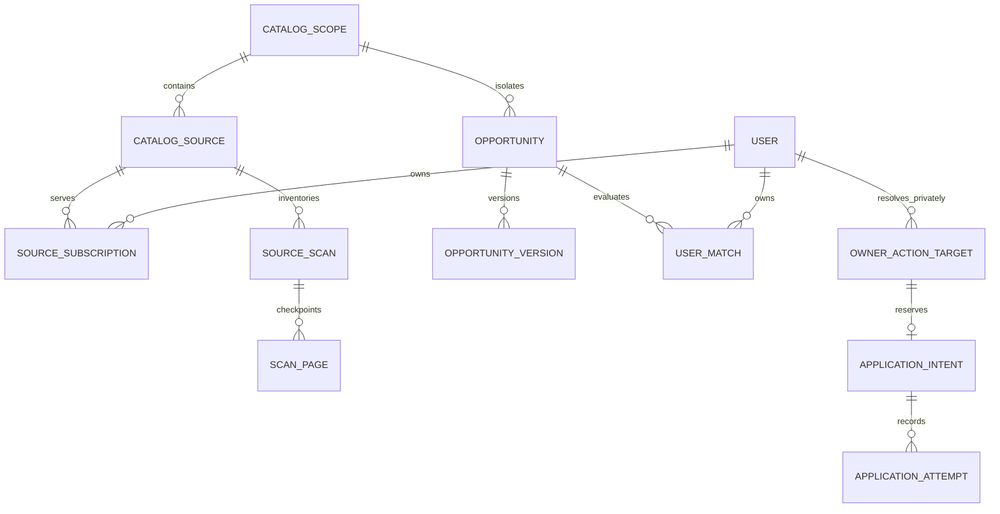

# InternPilot-AI — ordered implementation handoff

Specification date: 2026-10-28. Intended executor: a GPT-6 High coding agent working **one task at a time**. Status: documentation only; none of the future files, migrations, commands or performance results below should be assumed implemented.

Read this with the [evidence-backed audit](ENGINEERING_AUDIT.md), [production architecture](PRODUCTION_ARCHITECTURE.md) and [complete UI/UX specification](UI_UX_REDESIGN_SPEC.md). The audit describes current behavior; architecture and UI documents describe targets. This file fixes execution order, scope, validation and completion evidence. Preserve these distinctions in every report.

## A. Execution contract

1. Inspect the cited current files and tests before each task. Preserve public behavior, user IDs, encrypted records, hackathons, owner audit controls, consent and demo separation. Do not replace the stack or delete working features for convenience.
2. Implement the smallest reviewable change satisfying that task. Stop broadening it once its tests and acceptance criteria pass. If a task needs several patches, keep the intermediate state compatible and feature-flagged; do not leave half-enabled data writers.
3. High-impact correctness work T01–T17 precedes cosmetic work. UI layout work can use existing functional APIs, but must never display an unsupported backend capability as available. T24–T27 refine outbound/artifact isolation; they do not activate external sending/submission.
4. All outbound tests use controlled transports, synthetic identities and the authorized local test portal. No real external application, document upload, Gmail message, notification or contact outreach without specific authorization. No bypass of robots/login/CAPTCHA/MFA/terms. Real-source read verification is a separate permitted, bounded task.
5. Use disposable databases and generated test keys; never consume the user's `.env`, production DSN, private documents or real OAuth tokens for tests. A temporary SQLite database cannot certify PostgreSQL concurrency, RLS or index performance.
6. Keep v1 endpoints/IDs and old record downloads working through compatibility adapters. Introduce v2 rather than silently changing numeric pagination, exact-total semantics or status meanings. Legacy endpoints may retain legacy costs temporarily; measure them and retire only under an explicit compatibility decision. New performance gates apply to v2.
7. No tests or benchmarks count as passed unless executed with an exit code and retained evidence. If infrastructure is missing, complete independent work, record the exact unexecuted gate/blocker, and do not claim that phase is production-validated.
8. Existing user direction stopped Git/hosting operations. This specification defines CI/CD and GitHub-ready artifacts; it does not authorize creating repositories, pushing commits, enabling paid resources or deployment.

Fixed architectural decisions: modular Next.js/FastAPI; SQLAlchemy/psycopg; PostgreSQL authoritative data, queue and provider budgets; optional Redis cache/wakeups; same backend image with bounded roles; trusted controller plus isolated browser/parser runners; deterministic matching first. No Kafka/Kubernetes/service split/vector store or additional job framework. One query-cache library is allowed in T18; test-only load/accessibility tools are allowed in their tasks. Optional object storage is threshold/capability gated, not a compulsory cloud dependency.

### Scope-specific invariants the coding agent must retain

- Stable source identity excludes mutable policy version. It includes catalog scope, connector, endpoint/parameters and credential principal when applicable.
- New inventory scan increments source generation once; retries/page continuations keep it. Every claim/reassignment increments a separate attempt epoch. Use fresh database time after locks at fencing boundaries.
- Strict connector schema and explicit completeness precede absence/closure. Positive facts may publish in fenced batches; details budgets never imply complete listing coverage. Unchanged immutable inventory revisions advance source verification without touching every membership row.
- Public/private catalog records remain scoped. Private owner-level action identity can recognize one actual requisition across that owner's visible scopes without merging private content globally.
- Outbox consumers claim unprocessed delivery intents; no global sequence high-water mark can prove lower IDs committed. Private SSE replay uses a per-owner counter locked through commit.
- Profiles, opportunities, rule evaluations and published recommendation generations are versioned. Profile changes rebuild unchanged-listing recommendations too. Current exact checks gate actions; stale cached scores never do.
- After provider timeout/crash/restore, ambiguous external effects are `uncertain`, not failed-and-retryable. Provider acceptance, successful inbox delivery and application confirmation are different evidence.
- Every migration/restore must retain compatible keys/artifact versions and replay suppression/deletion/consent tombstones before private data/outbound work resumes.

## B. Command conventions and evidence

Commands below assume the repository root unless prefixed **B** (run from `backend/` with its virtual environment activated) or **F** (run from `frontend/` with the installed Node environment). On Windows activate `backend/.venv/Scripts/Activate.ps1`; on Unix use `source backend/.venv/bin/activate`. Match installed tool versions/lockfiles. Do not put secrets into command arguments or reports.

Path shorthand in task **Files** lists is fixed: bare backend module names resolve under `backend/app/`, `tests/test_*.py` under `backend/tests/`, and `migrations/` under `backend/app/migrations/`. Bare component `.tsx` names resolve under `frontend/src/components/`, while `page.tsx`, `layout.tsx` and named application CSS files resolve under `frontend/src/app/`. Frontend package/lockfile means `frontend/package.json` / `frontend/package-lock.json`; backend Dockerfile means `backend/Dockerfile`; cloud Compose/env examples mean `deploy/compose.cloud.yaml` / `deploy/cloud.env.example`. Newly proposed paths are marked new/create and are owned by that task. On Windows PowerShell versions without `&&`, execute the listed checks sequentially and stop on each nonzero exit, or use `scripts/check.py` once T01 supplies it.

Currently available baseline commands, inspected in source (not executed for this specification):

| Name | Working directory / exact command | What it establishes |
| --- | --- | --- |
| B-test | B: `python -m pytest -q -p no:cacheprovider` | Existing backend regressions, under an explicitly isolated environment. |
| B-lint | B: `python -m ruff check app tests` | Existing backend lint policy; Ruff must be installed from dev requirements. |
| F-check | F: `npm run lint && npm run typecheck && npm run build` | Production compile/types/lint, not responsive/accessibility performance. |
| UI-current | Root: `python scripts/run-ui-acceptance.py --studio-ui` | Fresh SQLite API + built Next, without crawl worker; requires free 8000/3000 and browser dependencies. |
| Q-current | Root: `python scripts/benchmark-opportunity-query.py` | Fixed 10k SQLite newest-page check, one measurement, no HTTP. Writes a historical-shaped artifact. |
| Queue-current | Root: `python scripts/benchmark-queue.py` | 1k-source SQLite schedule/claim check, no HTTP crawling. |
| PG-current | Root: `python scripts/verify-postgres-upgrade.py --container <local-test-container> --host <private-test-IP>` | Creates/removes scratch role/database on an existing local Docker PostgreSQL instance; current version assertions are hardcoded through v5. Linux/Docker-specific, not a portable load harness. |

Default/regional/production modes of the current UI runner can start a crawl worker and perform public reads. Do not label every current UI mode offline. T01/T30 must make a deliberate replay/offline CI mode and preserve useful existing browser cases when routes change.

**Future commands are contracts to implement, not currently runnable tools.** Every new test module named in a task must be created in that task. A future command appears only after its providing task has completed. In particular `scripts/check.py`, `scripts/catalog-migrate.py`, `scripts/perf.py`, new UI suites and `compose.perf.yaml` do not exist at the start of this specification.

Required completion report for each task:

- Changed files, task ID, audit findings addressed, and remaining boundaries.
- Exact executed commands/environment class, exit codes, pass counts and report paths; explicitly list skipped gates.
- Migration versions and compatibility flags, plus rollback rehearsal/result where applicable.
- Only measured timings/costs. Link independent semantic/failure counterexample evidence, not only happy-path tests.
- Update `docs/EXECUTION_STATUS.md` (create in T01) with `not_started / in_progress / blocked / implemented_unverified / verified`, prerequisites and evidence. “Code written” is not “production-ready.”

## C. Phases, dependency and migration order

| Phase | Tasks | Exit gate |
| --- | --- | --- |
| P0 Protect existing correctness | T01–T05 | Partial/malformed inventories, stale workers and observed replies cannot cause the audited wrong outcomes. |
| P1 Bound runtime work | T06–T09 | No blocking ORM/provider waits on worker loops; admission, quotas and real role health behave under failures. |
| P2 Expand data and events | T10–T14 | Scoped shared catalog, private invariants, loss-safe events, resumable backfill and one authoritative writer per source group. |
| P3 Bounded reads and decisions | T15–T18 | Indexed v2 reads, versioned/rebuilt matches, optional AI budgets and targeted client resources. |
| P4 Premium interface | T19–T23 | Routed responsive core workflows, truthful data, complete states and keyboard accessibility. |
| P5 Action isolation and recovery | T24–T28 | Auditable action identities, sandboxed runners, compatible artifact/key recovery, provider cursors and polished operational/account flows. |
| P6 Prove and package | T29–T32 | Reproducible load/failure evidence, gated CI/CD, restore rehearsal and honest portfolio/documentation. |


The numeric order is the default safe execution order. Tasks may depend on more than their predecessor, as specified below. Do not parallelize migrations or concurrent edits to the same source files. A failed gate blocks enabling its dependent feature, not independent documentation/tests.

### Reserved migration ledger

Current numbered versions are 1–5. Reserve the next versions as follows; if a new version was added outside this handoff, rebase the **unapplied** numbers once and record the mapping before coding. Never rewrite an applied migration.

| Version | Owner task | Additive scope |
| --- | --- | --- |
| 006 | T03 | Attempt epochs, stable inventory generation/policy fence, explicitly legacy-prefixed scan/page/inventory tables, immutable task-attempt evidence. |
| 007 | T05 | Per-sender/thread provider cursors, suppression/send-attempt fields needed for exact follow-up checks. |
| 008 | T07 | Shared auth/resource quota buckets and reservations. |
| 009 | T08 | Worker role/build/progress heartbeat fields. |
| 010 | T09 | Hierarchical provider budgets, leased request permits and source circuit state. |
| 011 | T10 | Scoped global catalog, immutable inventory/version/identity tables, subscriptions, scope-aware task fields and legacy mapping/barrier tables. |
| 012 | T11 | Private evaluation/ranking generations, owner action-target identity, purpose-specific approvals and document version counters; constraints/RLS policies. |
| 013 | T12 | Outbox deliveries, private change-log counters/retention and consumer state. |
| 014 | T15 | Search/read-model indexes and query-compatible projections; concurrent indexes use an explicit nontransactional phase. |
| 015 | T17 | Scoped model-result/singleflight/token-budget records. |
| 016 | T26 | Artifact object/key-version metadata, recoverable tombstones and lifecycle ledger where not already represented by 012. |

Migration requirements for every version: immutable definition; fresh and historical upgrades; idempotent runner/retry; production lock and explicit short lock/statement timeouts; no provider requests, all-user backfills or blob copies inside DDL transaction. Add constraints unvalidated where supported, report violations, then validate online. `CREATE INDEX CONCURRENTLY` cannot run inside the current `engine.begin()` migration transaction; persist a separate step and clean failed invalid indexes safely. Freeze an explicit v5 bootstrap schema for fresh installations rather than treating mutable current ORM metadata as historical v1; retain upgrade paths from genuine v1–v5 fixtures. Keep PostgreSQL schema changes and SQLite local compatibility explicit.

**Early inventory ownership:** migration 006 owns `legacy_source_scans`, `legacy_scan_pages`, `legacy_inventory_revisions`, `legacy_inventory_pages` and `legacy_source_memberships`, keyed to the existing owner-specific `Source.id`. Source fields include `inventory_generation`, `active_scan_id`, `access_policy_version`; Task includes `attempt_epoch`. Pages have unique scan/page keys and validated content hashes; revisions reference immutable ID pages and previous revisions; memberships update only on actual presence/evidence changes. T04 uses these tables while old Sources remain authoritative, retaining old cache-shaped response adapters. Migration 011 creates the separate scoped `source_scans`, `scan_pages`, `inventory_revisions`, `inventory_pages` and `source_listings` described by the architecture. T13 maps legacy IDs/revisions through immutable mapping records, and T14 transfers the entire source equivalence group at a recorded fence/barrier. Do not create two incompatible tables with the same name, let both stores write authority simultaneously, or drop the legacy tables until the contract/retention gate.

### Logical ownership and fencing views

These are target diagrams, not assertions that tables exist. Actual composite constraints/RLS and nullable public ownership follow the architecture.



```mermaid
sequenceDiagram
  participant A as Worker A
  participant DB as PostgreSQL
  participant B as Worker B
  participant P as Replay provider
  A->>DB: Claim epoch 1, scan generation G
  A->>P: Fetch page outside transaction
  A->>DB: Fenced page 1 and continuation commit
  Note over A,DB: A stalls; lease expires
  B->>DB: Claim epoch 2, retain generation G
  B->>P: Continue page 2
  A->>DB: Attempt stale epoch 1 write
  DB-->>A: Reject without side effects
  B->>DB: Fresh-time epoch/policy fence after locks
  B->>DB: Commit page, complete marker and outbox intent
```

## D. Common release targets

These are future gates, not measured results. Every load report names hardware, exact dataset, network/TLS mode, software versions and denied/unsupported checks.

| Domain | Required target / invariant |
| --- | --- |
| Correctness | Zero accepted stale-epoch writes, malformed/partial closure events, cross-owner accesses or unapproved outbound actions in deterministic failure tests. Exact synthetic expected-result corpus for filters, deadlines and eligibility. |
| API | v2 list/detail p95 <=300 ms and p99 <=1 s at 50 read RPS on the declared reference setup; overview p95 <=200 ms. <=50 list items and <=100 KB compressed default response. No request-time full-catalog scoring. |
| Queue/crawl | p95 eligible scheduling delay <=60 s; stable-provider discovery normally <=effective interval +2 min. Simulated 1,500-source nominal 5 HTTP requests/s plus 20% allowance for two hours, within actual per-provider budgets; mandatory cooldowns are separately reported. |
| Matching/events | Normal active-cohort match lag p95 <=2 min; normal outbox lag p95 <=5 s, <=60 s in declared bursts. Profile/rules edits invalidate/rebuild unchanged opportunities. No unbounded users × history fan-out. |
| Frontend | <=one SSE stream/active tab, <=two idle conditional requests/minute excluding heartbeats. No nine-endpoint timer. Route/back/forward/reload parity; no account-switch stale data. Mobile p75 LCP <=2.5 s / INP <=200 ms on the declared midrange device/network profile. |
| Accessibility | WCAG 2.2 AA target; text >=4.5:1, large text/non-text UI >=3:1 where applicable; keyboard-only drawer/filter/pipeline/account flows; 200% zoom/reflow and reduced-motion checks. Zero serious/critical automated accessibility findings, with manual tests recorded. |
| Isolation/recovery | No provider I/O while holding DB locks; sandbox runners have no global keys/DB access. Test restored records/artifacts/keys and private deletion/suppression replay before outbound reactivation. Target RPO/RTO depends on deployed tier; source files do not establish either. |

## E. Ordered coding tasks

### T01 — Freeze baseline evidence and safe test entry points

- **Scope/dependencies:** first task; no production behavior change. Inspect existing tests, lockfiles, `.env.example` (never actual secrets), migration runner and scripts before changing test infrastructure.
- **Files:** existing `scripts/run-ui-acceptance.py`, `scripts/verify-postgres-upgrade.py`, `scripts/test.ps1`, `.github/workflows/ci.yml`, `backend/tests/`, `frontend/package.json`; create `scripts/check.py`, `compose.test.yaml`, `backend/tests/support/`, `docs/EXECUTION_STATUS.md`, `docs/validation/BASELINE.md`.
- **Expected behavior:** `check.py` supplies documented `backend`, `frontend`, `postgres`, `ui` suites with isolated temporary settings; scrub provider variables before imports. Its PostgreSQL mode owns a fresh labeled `compose.test.yaml` stack/run-marker DB and limited roles, rather than borrowing production Compose or requiring an existing private test IP. Do not expose Docker socket/admin credentials inside app/tests. Exit nonzero on unavailable mandatory tools, never silently fall back from PostgreSQL. Capture current regressions and known failing counterexamples separately. Preserve existing scripts; make UI replay/offline mode explicit. Update schema-version assertions to test the declared latest version without dropping historical fixtures.
- **Verify:** existing B-test, B-lint, F-check and UI-current where supported; new root `python scripts/check.py backend`, `python scripts/check.py frontend`, `python scripts/check.py postgres --fresh`.
- **Acceptance:** no user's DB/config opened, generated credentials redacted, clean temp resources; baseline reports record actual commands/results. The current 10k SQLite and queue checks are labeled accurately.
- **Complete/rollback:** isolated harness and baseline evidence reproducible; no claim that unexecuted suites pass. Restore previous test entry points if broken; application state is untouched.

### T02 — Strict connector contracts and fail-safe completeness

- **Scope/dependencies:** T01; audit F01/F02. Fix the immediately dangerous empty/partial semantics before full pagination.
- **Files:** `backend/app/discovery.py`, `opportunity_sources.py`, `aggregation.py`, `services.py`; create `backend/app/discovery_contracts.py`; extend `backend/tests/test_discovery.py`, `test_opportunity_sources.py`, `test_aggregation.py`, `test_service_guards.py`.
- **Expected behavior:** typed result with provenance, schema version, listings/records, continuation, completeness enum and not-modified evidence. Missing/wrong collection type, error-shaped 200 and invalid metadata fail as source/schema errors. Valid empty boards are explicit. SmartRecruiters detail cap immediately marks inventory partial until T04 implements coverage. Preserve current connector fact/expiry/remote/hackathon semantics.
- **Verify:** B: `python -m pytest -q tests/test_discovery.py tests/test_opportunity_sources.py tests/test_aggregation.py tests/test_service_guards.py`; B-lint.
- **Acceptance:** 30 SmartRecruiters postings never produce false completeness; malformed Greenhouse/Ashby/Workday/SmartRecruiters preserves existing active inventory and does not report a healthy empty scan. Reference feeds cannot close official listings; valid zero inventory follows the declared closure policy.
- **Complete/rollback:** contract fixtures and downstream closure tests pass, v1 consumers remain compatible via adapter. Rollback may disable a connector; never reenable the unsafe silent-empty fallback.

### T03 — Fence task side effects and inventory generations

- **Scope/dependencies:** T02; F03/F15 foundations. Implement migration 006 before deploying fenced workers; explicitly stop/drain old workers at writer rollout.
- **Files:** `backend/app/models.py`, `migrate.py`, `worker.py`, `services.py`, `main.py`; create `backend/app/migrations/` definitions, `backend/tests/test_task_fencing.py`; extend `test_worker_reliability.py`, `test_api_worker.py`, `scripts/verify-postgres-upgrade.py`.
- **Expected behavior:** claim/reassignment increments attempt epoch, new scan increments source generation once, continuation/retry retains scan generation. Pass identity to discovery. Stage/finalize conditionally on current task epoch, live lease using fresh DB time after locks, source generation and policy version. Source mutation endpoints bump the fence on permission/connector/endpoint configuration changes and explicitly invalidate affected scans. Reaper/writer lock order documented; obsolete/disabled/deleted/policy-revoked scans cannot commit. Append attempt evidence instead of erasing it when an intent is reused.
- **Verify:** B: `python -m pytest -q tests/test_task_fencing.py tests/test_worker_reliability.py tests/test_api_worker.py`; root `python scripts/check.py postgres --fresh`.
- **Acceptance:** barrier A stalls, lease expires, B commits, A resumes: A changes no authoritative opportunity/cache/event. Restart page 2 keeps generation; lease never revives; approval checkpoints retain existing protections. Test on actual PostgreSQL with non-superuser application role.
- **Complete/rollback:** old/new worker version floor documented; upgrade fixture decrypts old profile/docs. Pause affected role and forward-fix; never roll back to concurrent unfenced writers.

### T04 — Resumable complete inventories and bounded diff reconciliation

- **Scope/dependencies:** T03; F01/F09. Add durable pagination and separate listing presence from details.
- **Files:** `discovery.py`, `discovery_contracts.py`, `services.py`, `worker.py`, `opportunity_sources.py`; extend `tests/test_discovery.py`, `test_service_guards.py`; create `tests/test_inventory_reconciliation.py`.
- **Expected behavior:** SmartRecruiters/Workday follow validated continuations within budgets; stage ID inventory separately from changed details. Provider 304/unchanged full-inventory hash references immutable prior inventory and updates O(1) source verification state. Changed scans diff IDs/pages without every-row timestamp rewrites. Partial/non-snapshot offsets yield absence candidates requiring authoritative checks, not immediate closures. Publish valid positive facts in bounded batches; closure work checkpoints against complete immutable revision.
- **Verify:** B: `python -m pytest -q tests/test_inventory_reconciliation.py tests/test_discovery.py tests/test_service_guards.py`; `python scripts/check.py postgres --fresh` from root.
- **Acceptance:** 30/150/1,000 listing fixtures eventually cover all IDs; changed/reordered/expired pages, restart, repeated 304 and missing detail cases produce correct status. Unchanged 1,000-member inventory uses a bounded constant verification-write count. No obsolete generation closes new facts.
- **Complete/rollback:** contract coverage/cursors/write counts recorded; real source access unchanged. Disable connector/detail continuation if broken, retain inventory/evidence, never replace with fabricated completeness.

### T05 — Exact-thread follow-up safety and sender state

- **Scope/dependencies:** T03/T04; F04/F13. Migration 007. Keep existing per-message approvals and send limits.
- **Files:** `outreach.py`, `gmail.py`, `outreach_api.py`, `outreach_schemas.py`, `models.py`, migrations; extend `tests/test_outreach.py`; create `tests/test_outreach_suppression.py`.
- **Expected behavior:** follow-ups verify the exact recipient/thread, process unprocessed messages beyond the first 100, and stop on known reply/opt-out/bounce. Stale/failed verification blocks send. Persist sender/thread cursors/suppression, correlate identity and verified sender; refresh tokens without a synchronous lock held across network I/O. Reservations remain durable; ambiguous sends are not retried.
- **Verify:** B: `python -m pytest -q tests/test_outreach.py tests/test_outreach_suppression.py`; root PostgreSQL suite.
- **Acceptance:** 26+ threads, target outside old batch, >100-message thread, concurrent reply/send, expired token and revoked consent tests cause zero prohibited mock sends. Observe cross-system race limits honestly. No live Gmail credentials required.
- **Complete/rollback:** all current approval tests plus new failure cases pass. Pause outreach on regression; retain suppression/reservations and never roll back their data.

### T06 — Async worker/database boundaries and bounded CPU work

- **Scope/dependencies:** T05; F05. No unrelated endpoint rewrite or driver replacement.
- **Files:** `database.py`, `worker.py`, `services.py`, `gmail.py`, `rate_limits.py`, `main.py`, `config.py`; create `backend/app/db_async.py`, `tests/test_async_boundaries.py`; adapt worker/Gmail tests.
- **Expected behavior:** use installed SQLAlchemy/psycopg async support for worker/control/realtime DB paths. Existing sync FastAPI routes may remain on separately bounded pools. No Session shared across tasks, no checkout during provider waits. Short reserve/I/O/finalize units; bounded CPU handoff and explicit hard timeouts, preparing for T25 sandbox isolation.
- **Verify:** B: `python -m pytest -q tests/test_async_boundaries.py tests/test_worker_reliability.py tests/test_outreach.py tests/test_service_guards.py`; root PostgreSQL suite; B-lint.
- **Acceptance:** injected slow DB/provider/parser does not block unrelated heartbeat/event-loop progress; no lock spans an awaited provider request. Pool totals include sync+async paths, cancellation releases connections, lost leases still reject effects.
- **Complete/rollback:** measured lag/checkout trace from controlled test; no unsupported throughput claim. Switch one role back only to a bounded safe execution path; keep fencing/schema compatibility.

### T07 — Shared authentication limits and resource quotas

- **Scope/dependencies:** T06; F11/F12. Migration 008; preserve authentication/RBAC/owner step-up.
- **Files:** `main.py`, `account_security.py`, `owner_console.py`, `body_limit.py`, `config.py`, `security_logs.py`, `models.py`; new `backend/app/quotas.py`, `tests/test_quotas.py`; existing auth/owner/security tests.
- **Expected behavior:** TTL-bounded shared IP/account throttles with explicit trusted-proxy policy and stricter DB fallback/fail-closed behavior when optional Redis is down. Durable per-owner discovery, upload bytes/storage, imports and generation quota reservations. Manual refresh honors next-allowed-at and coalesces queued work. Resource caps produce actionable 429/retry metadata.
- **Verify:** B: `python -m pytest -q tests/test_quotas.py tests/test_account_security.py tests/test_owner_console.py tests/test_service_guards.py`; PostgreSQL suite.
- **Acceptance:** two API processes/restart cannot reset shared quota; spoofed forwarding headers do not select arbitrary identity; legitimate users behind a trusted proxy are separated; source Retry-After wins over manual refresh; no key retention leak or PII in limiter logs.
- **Complete/rollback:** documented quota defaults/environment examples and failure tests. Disable expensive actions rather than silently removing limits during limiter failure.

### T08 — Role-aware health and structured operational telemetry

- **Scope/dependencies:** T06/T07; F17. Migration 009. Metrics must derive from actual execution.
- **Files:** `monitoring.py`, `worker.py`, `operations_api.py`, `logging_config.py`, `main.py`, `models.py`, `deploy/start.py`; extend `tests/test_reminders_monitoring.py`, `test_production_upgrade.py`; new `tests/test_worker_roles.py`.
- **Expected behavior:** heartbeat stores roles/build/host/capacity/progress; health reports per-kind queued age, active capacity, failed/expired/stale-write counts and DB/worker degradation separately. Bounded metric label cardinality; secrets/PII redacted. API readiness does not crash-loop merely because one provider is down.
- **Verify:** B: `python -m pytest -q tests/test_worker_roles.py tests/test_reminders_monitoring.py tests/test_production_upgrade.py tests/test_hosting.py`; PostgreSQL suite.
- **Acceptance:** outreach-only worker reports zero discovery capacity; missing parser/browser capability is visible, queue age advances, no simulated animation counters. DB outage exposes unavailable rather than false-ready. No per-source/user IDs as metric labels.
- **Complete/rollback:** sample actual structured logs/health snapshots, schema upgrade tested. Keep old response fields via adapter; new fields optional for old clients.

### T09 — Hierarchical provider admission, fair scheduling and breakers

- **Scope/dependencies:** T04/T06/T08; F11/F18. Migration 010; keep PostgreSQL as authoritative budget coordinator.
- **Files:** `rate_limits.py`, `worker.py`, `discovery.py`, `config.py`, `source_catalog.py`, `regional_search.py`, `models.py`; new `tests/test_provider_admission.py`; extend `test_discovery_fairness.py`, `test_worker_reliability.py`.
- **Expected behavior:** provider→origin→source/credential budgets, leased concurrency permits longer than request deadline, source cooldown and circuit state, fixed lock ordering. Deferred budget work releases worker slots and checkpoints. Jittered bounded scheduling, small/new-source fair share and bounded demand priority; no global error-ratio punishment for healthy hosts.
- **Verify:** B: `python -m pytest -q tests/test_provider_admission.py tests/test_discovery_fairness.py tests/test_worker_reliability.py tests/test_discovery.py`; PostgreSQL suite.
- **Acceptance:** multiple workers cannot exceed configured rate/concurrency or Retry-After; crashed permits expire safely; one host outage does not halve healthy-host capacity. Infeasible freshness becomes an explicit longer effective interval. Pending scan intents remain bounded per resource.
- **Complete/rollback:** deterministic clock/multiprocess evidence; per-source desired/effective schedule exposed. Pause policy groups during coordinator failure; no independent conflicting Redis limiter.

### T10 — Add scoped public catalog schema and immutable mappings

- **Scope/dependencies:** T09; F08/F09/F14/F21. Migration 011; shadow schema only, no writer cutover.
- **Files:** `models.py`, `migrate.py`, migrations, `database.py`, `schemas.py`; create `backend/app/catalog_models.py`, `catalog_contracts.py`, `catalog_identity.py`, `tests/test_catalog_schema.py`; update PostgreSQL migration verifier.
- **Expected behavior:** architecture §4 tables for scopes/sources/subscriptions, versions/locations/skills, inventory revisions/listings, scoped provider/URL aliases and legacy mapping/barrier state. Add explicit public/private task scope and resource identity; public tasks may have no owner only under a scope/kind check, while existing private tasks retain their owner. Stable identity excludes mutable policy version. No synthetic all-powerful system-user owner. Public/private source classification starts private unless reviewed public.
- **Verify:** B: `python -m pytest -q tests/test_catalog_schema.py tests/test_opportunity_sources.py tests/test_geography.py`; PostgreSQL fresh/historical migration suite.
- **Acceptance:** scope uniqueness and FK invariants enforced; same public source can be shared without publicizing private feeds; mutable policy edits preserve identity; no existing row/ID/blob is altered or hidden. Fresh and upgraded schemas agree.
- **Complete/rollback:** schema diagram and migration manifest, forward/down-compat tests. Keep new schema unused behind flag if problems arise; no destructive down migration.

### T11 — Private matches, action identity, document counters and tenant constraints

- **Scope/dependencies:** T10; F10/F14/F15. Migration 012, no external capability activation.
- **Files:** `models.py`, `catalog_models.py`, `security.py`, `account_security.py`, `services.py`, migrations; create `backend/app/private_models.py`, `tenant_context.py`, `tests/test_tenant_invariants.py`, `test_action_identity.py`, `test_document_versions.py`.
- **Expected behavior:** versioned profile/match state, bounded recommendation-generation projection, private owner/action target bridging trusted visible public/private requisitions, unique future intent/reservations, purpose-specific approval records. Atomic document counter with explicit NULL scope uniqueness. Add correct owner FKs/composites and RLS, separate migrator/API/crawler/matcher/provider roles. Existing authorized owner inspection uses a narrowly scoped privileged admin transaction only after server-verified step-up/purpose and an audit write; normal API/crawler roles gain no general RLS bypass. Retain valid owner-admin workflows while rejecting ordinary cross-owner access.
- **Verify:** B: `python -m pytest -q tests/test_tenant_invariants.py tests/test_action_identity.py tests/test_document_versions.py tests/test_owner_console.py tests/test_documents.py`; actual non-superuser PostgreSQL tests.
- **Acceptance:** invalid/cross-owner inserts and cached/download/job-ID access fail; pooled owner context never leaks; current scrypt remains unreadable; 20 concurrent same-scope document generations have unique versions. Same verified requisition in public/private scopes yields one private action identity; ambiguous aliases require review, without public data merge.
- **Complete/rollback:** orphan report before constraint validation; no private data loss. Existing history remains readable; old privileged writer roles cannot bypass new scope rules after activation.

### T12 — Transactional outbox and loss-safe user change replay

- **Scope/dependencies:** T11; migration 013. Must exist before the shared writer goes live.
- **Files:** `realtime.py`, `services.py`, `main.py`, `worker.py`, `models.py`, migrations; create `backend/app/events.py`, `event_dispatcher.py`, `tests/test_event_replay.py`.
- **Expected behavior:** state changes and small scoped events/delivery intents commit atomically. Consumers claim unprocessed delivery rows with idempotent effects; no unsafe global sequence watermark. Private change cursor uses per-owner counter locked through commit. SSE verifies auth, has bounded buffers/replay and no held DB session; optional Redis is wakeup only, with bounded per-process DB fallback.
- **Verify:** B: `python -m pytest -q tests/test_event_replay.py tests/test_api_worker.py tests/test_account_security.py`; PostgreSQL concurrency suite; controlled reconnect/Redis loss script added to `check.py`.
- **Acceptance:** reversed-commit transactions cannot skip events; duplicates/out-of-order events cannot regress versions; lost Redis and slow clients recover by cursor; expired cursor triggers explicit refresh. Source heartbeats do not fan out personal feed events to all subscribers. No scope/private payload leaks.
- **Complete/rollback:** crash-boundary/replay evidence and retention behavior documented. Disable wakeups and use bounded durable polling; never discard pending outbox intent or replay external sends.

### T13 — Resumable legacy backfill and collision reporting

- **Scope/dependencies:** T10–T12; shadow data only. Preserve user documents/history.
- **Files:** new `scripts/catalog-migrate.py`, `backend/app/catalog_migration.py`, `tests/test_catalog_backfill.py`; existing `migrate.py`, `catalog_identity.py`, model mapping definitions; docs migration runbook.
- **Expected behavior:** proposed CLI: `plan`, `backfill --batch-size 500`, `verify`, `status`. Require disposable/staging authorization and DSN from protected environment, dry run by default. Capture old writes into transactional migration log; map IDs immutably, classify scopes, resumable keysets/checksums, and collision reports. No all-user work inside DDL startup transaction.
- **Verify:** B: `python -m pytest -q tests/test_catalog_backfill.py`; root `python scripts/catalog-migrate.py plan --fixture legacy-v5` creates one labeled scratch fixture and returns a run ID/manifest; reuse it with `python scripts/catalog-migrate.py backfill --run-id <id> --batch-size 500`, `python scripts/catalog-migrate.py verify --run-id <id>`, then `python scripts/catalog-migrate.py cleanup --run-id <id>`. Resume the same fixture after interruption; never create a fresh fixture for each subcommand or fall back to the user's DSN.
- **Acceptance:** interrupt every batch boundary, resume without duplicates; multi-source alias/country/unknown/hackathon facts preserved; encrypted documents decrypt identically; submitted histories never dropped to satisfy uniqueness. Private source cannot be promoted from URL similarity alone.
- **Complete/rollback:** fixture reconciliation manifest with counts/hashes/quarantined ambiguities. Pause/discard only derived shadow copies; original state remains authoritative.

### T14 — Cut over one shared public writer per source equivalence group

- **Scope/dependencies:** T13 verified; F08. First enable a small permitted provider subset, then expand only after parity.
- **Files:** `services.py`, `worker.py`, `discovery.py`, `operations_api.py`, `source_catalog.py`, `main.py`, `config.py`, worker role/deployment configuration; new `backend/app/catalog_ingest.py`, `catalog_access.py`; extend migration CLI; create `tests/test_shared_discovery.py`, `test_catalog_cutover.py`.
- **Expected behavior:** one physical fetch per shared source window, subscriber-independent normalization and global evidence. Scope all data/events. Give shared work a distinct `catalog_discovery` task kind/handler capability so an old owner-based `discovery` worker cannot claim an ownerless global task; update supported role validation and show discovery capacity by both compatible kinds during transition. Fence/drain every old owner-specific source in the equivalence group, replay committed migration barrier, then enable one new writer. No late migration event can overwrite newer catalog facts. Subscription pause affects that owner only; saved/application historical access remains authorized. Editing a public endpoint creates/resolves the new stable source identity and repoints the subscription, rather than silently retargeting a shared source for other users.
- **Verify:** B: `python -m pytest -q tests/test_shared_discovery.py tests/test_catalog_cutover.py tests/test_inventory_reconciliation.py tests/test_tenant_invariants.py`; root migration fixture `verify`; controlled provider replay.
- **Acceptance:** 100 synthetic subscribers share one fetch; two old owners actively scanning cannot cross the cutover barrier; invalid snapshot cannot close jobs; profile 2027/2029 differences do not remove either user's shared opportunities. Private scopes remain isolated. Old-shaped v1 IDs resolve through authorized maps.
- **Complete/rollback:** pilot parity/fetch-count evidence and write-authority ledger. Stop new writer, drain/fence attempts and use compatibility projection; never enable simultaneous old/new authority.

### T15 — Indexed v2 catalog APIs, search, compact DTOs and summaries

- **Scope/dependencies:** T14; F06. Migration 014 indexes, including separate concurrent step.
- **Files:** `opportunity_query.py`, `main.py`, `services.py`, `discovery_filters.py`, `catalog_contracts.py`; create `backend/app/catalog_query.py`, `api_v2.py`, `tests/test_catalog_query_v2.py`; extend `test_opportunity_query.py`.
- **Expected behavior:** typed indexed filters/locations/skills/status, deterministic seek cursors, optional as-of cached counts, full descriptions only in detail. Authorized single-ID SQL lookup, compact <=50-row lists, cheap summary projections. Preserve Unicode/literal-wildcard and missing/null semantics unless explicitly versioned. Unknown date/timezone and remote scope remain distinguishable. v1 compatibility remains functional.
- **Verify:** B: `python -m pytest -q tests/test_catalog_query_v2.py tests/test_opportunity_query.py tests/test_geography.py tests/test_discovery.py`; PostgreSQL EXPLAIN fixture; F-check if contract generation affects types.
- **Acceptance:** page N is seek-based, no all-candidate scoring/full ORM hydration; default list <=100 KB compressed; newest cutoff and stale/invalid cursor behavior tested; expired records never confidently open if expiry job stops. SQL statement/evaluation counts bounded at 10k and 100k scratch data. Formal 1M performance gate is T31, not claimed here.
- **Complete/rollback:** captured query plans + semantic parity corpus, safe parameterization and scope checks. Route readers back to compatibility projection; do not roll back data authority or return fictitious counts.

### T16 — Versioned recommendations and profile/rules rebuilds

- **Scope/dependencies:** T11/T12/T15. Preserve conservative matching/hackathon rules; no LLM requirement.
- **Files:** `matching.py`, `opportunity_intelligence.py`, `geography.py`, `services.py`, `worker.py`, `reminders.py`; new `backend/app/match_jobs.py`, `match_query.py`, `tests/test_match_generations.py`; existing matching/intelligence/geography tests.
- **Expected behavior:** coarse private routing, deterministic rejection/review before score; cache on profile/opportunity/rules versions. Changed records and edited profiles/rules both enqueue bounded coalesced work. Build top-N generation then publish atomically; retain current + prior for cursor TTL. Initial profile candidate pool cap 2,000 with explicit coverage. Exact saved/viewed/action checks remain available; urgency is time-based, not new model analysis.
- **Verify:** B: `python -m pytest -q tests/test_match_generations.py tests/test_matching.py tests/test_opportunity_intelligence.py tests/test_geography.py tests/test_reminders_monitoring.py`; PostgreSQL replay suite.
- **Acceptance:** adding a skill/location surfaces unchanged matching roles; stale rebuild cannot publish over new profile; rejected 2027-only role is ineligible for 2029; uncertain authorization stays review. Replay produces equivalent scores/reasons; no five-billion-row product. Published cursors remain stable or explicitly expire.
- **Complete/rollback:** versioned semantic corpus and measured evaluation/row counts. Keep deterministic on-demand fallback; mark stale coverage rather than inventing a current ranking.

### T17 — Optional AI singleflight and provider cost ceilings

- **Scope/dependencies:** T16; F16. Migration 015; disabled by default.
- **Files:** `llm.py`, `config.py`, `worker.py`, `catalog_ingest.py`, `match_jobs.py`; new `tests/test_model_budgets.py`; extend `test_llm.py`; `.env.example` documented variables only.
- **Expected behavior:** job-only annotation outside inventory critical path, scoped durable cache keyed by content/model/prompt/schema and private scope. Per-fingerprint singleflight and global provider/token/dollar reservations; failed/unknown output remains unverified. Extract only when useful to active eligible/review cohorts or explicitly requested; no resume/contact disclosure in public extraction.
- **Verify:** B: `python -m pytest -q tests/test_model_budgets.py tests/test_llm.py tests/test_matching.py`; PostgreSQL parallel singleflight tests.
- **Acceptance:** five concurrent identical descriptions cause one fake provider call across workers; different private scopes do not share; changed model/prompt invalidates; budget exhaustion/model timeout never blocks valid discovery. Quote-presence alone cannot upgrade an inferred legal/eligibility claim to fact.
- **Complete/rollback:** actual fake-call/token counters and provider-disabled parity. Disable AI flag without breaking matches or ingestion; retain deterministic outcomes.

### T18 — Typed frontend resources and normal routed navigation

- **Scope/dependencies:** T12/T15/T16/T17; F07/F20. Infrastructure/UI behavior before restyling.
- **Files:** `frontend/src/app/page.tsx`, `layout.tsx`, `components/opportunity-explorer.tsx`, `outreach-view.tsx`, `owner-console.tsx`, `automation-center.tsx`, `package.json`, lockfile; new `frontend/src/app/(workspace)/layout.tsx`, route pages from UI spec, `src/features/`, `src/lib/api-client.ts`, `query-keys.ts`, generated `api-types.ts`, auth/resource providers; new `scripts/ui-routes.py`, contract generation/check mode in `scripts/check.py`.
- **Expected behavior:** one TanStack Query runtime dependency, generated OpenAPI boundaries, private account/version keys, request cancellation/session epoch, feature routes, lazy heavy panels, URL filters and normal back/forward. Use a pinned maintained OpenAPI-to-TypeScript dev tool (such as openapi-typescript), not a custom partial schema generator; commit reproducible generated types and compare a temp regeneration in CI without needing Git writes. SSE invalidates only affected active queries with coalescing; cheap conditional fallback instead of nine-endpoint timer. Extract existing working features without redesigning their contents yet; preserve legacy root/auth redirects and Gmail callback routing.
- **Verify:** F-check; root `python scripts/run-ui-acceptance.py --routes-ui --offline` (flags/suite added here); B: existing auth/replay/API tests.
- **Acceptance:** reload/deep-link/back works for every mapped view; no cross-account stale data/cached drafts; hidden tab pauses fallback; idle network <=two conditional requests/minute excluding stream heartbeats. No provider acceptance status shown optimistically. Existing functionality inventory remains accessible.
- **Complete/rollback:** route/network/account-switch evidence and generated-type drift check. Route-level flag can retain old screen components temporarily; cache always cleared on owner change.

### T19 — Design tokens, accessible primitives and responsive shell

- **Scope/dependencies:** T18. Implement UI spec §§4–5 and 11–12 (foundations, shell, contracts and accessibility), not another ad hoc theme.
- **Files:** `globals.css`, `studio.css`, `layout.tsx`, `components/ui/button.tsx`, `theme-toggle.tsx`, workspace layout; create `src/styles/tokens.css`, `components/ui/{status-badge,field,empty-state,feedback,skeleton,drawer}.tsx`, `scripts/ui-foundations.py`. Inspect unimported `human.css`/`premium.css`; remove only after import/class audit and approved parity.
- **Expected behavior:** exact restrained light/dark tokens, type/spacing/radius/density hierarchy; one nav/content shell; accessible Radix dialog/drawer, focus rings, sufficient hit targets, reduced motion and semantic statuses. No glowing gradients/orbs/oversized metric tiles. No new UI framework/font service dependency.
- **Verify:** F-check; root `python scripts/run-ui-acceptance.py --foundations-ui --offline`; documented contrast calculation plus browser keyboard/zoom checks.
- **Acceptance:** UI spec viewport/theme/zoom matrix, visible focus, no content overflow at 320 px/200% zoom, theme loads without flash, no body/dialog focus escape. Buttons/inputs/errors use shared primitives; no giant legacy CSS specificity pile added.
- **Complete/rollback:** screenshots and contrast/keyboard report with synthetic labels, not product sample data. Roll back token/component scope without affecting routes or persisted preferences.

### T20 — Opportunity explorer, hackathons and detail drawers

- **Scope/dependencies:** T19/T15/T16. Highest-use surface; preserve local India/Nagpur/Pune and international filters.
- **Files:** `opportunity-explorer.tsx`, `opportunity-row.tsx`, `regional-discovery.tsx`, `opportunity-import.tsx`, new feature list/filter/drawer modules, `scripts/ui-explorer.py`; v2 DTO only if a documented data field is missing, with backend contract tests.
- **Expected behavior:** compact aligned rows, useful grouped/URL-persisted filters, actual stipend/prize/deadline precision, distinct publisher/reference verification and match/review rationale. Desktop adjacent drawer and mobile full-sheet, stable scroll, explicit new-results control, keyboard `/` search and safe list/drawer navigation. Single-character shortcuts ignore editable/IME/modal contexts and ship with an immediately accessible opt-out in the shortcut help menu; do not defer the opt-out until T28. Hackathon dates/registration/prizes remain separate facts; unknown remote/eligibility never inferred.
- **Verify:** F-check; root `python scripts/run-ui-acceptance.py --explorer-ui --offline`; B: v2 query/filter/intelligence tests.
- **Acceptance:** all combinations in independent semantic corpus return expected IDs; filters/chips clear consistently; no silent global/local eligibility assumptions; keyboard and mobile use complete without hover. Save/unsave real mutation, external URL validated; stale/empty/search-error states follow UI spec.
- **Complete/rollback:** desktop/mobile/light/dark screenshots, network/payload/scroll tests, no broken buttons or placeholder stats. Route-level component rollback leaves saved/filter data intact.

### T21 — Useful overview and saved opportunities

- **Scope/dependencies:** T20. Use actual cheap summaries rather than decorative analytics.
- **Files:** overview/saved route feature modules extracted from `page.tsx`, `opportunity-row.tsx`, summary API contract if required; `scripts/ui-overview.py`; backend summary tests.
- **Expected behavior:** recent relevant changes, review-needed actions, genuine upcoming deadlines and worker freshness; saved list with current state and preserved historical access. Count labels/time windows/denominators explicit; no invented trend graph. Meaningful empty onboarding with one next action. Saved records never disappear because a source was unsubscribed.
- **Verify:** F-check; root `python scripts/run-ui-acceptance.py --overview-ui --offline`; B: summary/saved/tenant tests.
- **Acceptance:** zero-data, partial-source failure, no matches, disabled worker, removed source and expired saved record cases; only data-backed counts; no root all-catalog job list fetch for this screen. Batch/pending/error state preserves user context.
- **Complete/rollback:** counts reconcile to independent fixture oracle and summary latency/evaluation counters. Revert view presentation only; never mutate saved/history to match a screenshot.

### T22 — Application pipeline and document studio

- **Scope/dependencies:** T21; existing T03/T11 safety remains active, advanced action boundary completes in T24.
- **Files:** `application-board.tsx`, `application-checklist.tsx`, documents view extracted from `page.tsx`, `documents.py` upload limits/capabilities DTO, application/document route modules; `scripts/ui-applications-documents.py`; document/automation tests.
- **Expected behavior:** clean status pipeline with accessible “Move to” controls; no drag interaction/library in this upgrade. Tracker moves only update user-reported tracking, never grant approval, mutate attempt evidence or manufacture confirmed submission. Distinguish manual tracking, preparation, approved upload, attempted and confirmed. Documents show original/proposal/verified versions with target, checksum/version and download; upload hint uses actual server 8-MiB limit unless deliberately versioned. Factual preview and missing inputs, no raw JSON dump as primary UX.
- **Verify:** F-check; root `python scripts/run-ui-acceptance.py --applications-documents-ui --offline`; B: `python -m pytest -q tests/test_documents.py tests/test_automation.py tests/test_document_versions.py`.
- **Acceptance:** mobile pipeline usable without horizontal drag dependency; keyboard moves persist and error rollback works. Wrong file type/8-MiB boundaries/parse failure/review proposal tested. UI cannot mark prepared as submitted or enable unsupported external Auto Apply. Existing version downloads decrypt correctly.
- **Complete/rollback:** synthetic local upload/doc generation and receipt UI evidence. Presentation rollback never changes application evidence or deletes document versions.

### T23 — Outreach and notification review surfaces

- **Scope/dependencies:** T22/T05. No real send; use explicit review queues and provider capability state.
- **Files:** `outreach-view.tsx`, `notification-settings.tsx`, notification view extracted from `page.tsx`, outreach/notification routes and feature components; `scripts/ui-outreach-notifications.py`; existing provider API tests.
- **Expected behavior:** recipient/sender/factual context, editable concise message preview, purpose-specific approval, scheduled/quiet/deferred/accepted/uncertain states and stop-on-reply explanation. OAuth reconnect and sender quota show actual backend status. Notifications group relevant events without duplicate alerts; external sends stay explicitly approved. Browser permission is requested only by deliberate user action.
- **Verify:** F-check; root `python scripts/run-ui-acceptance.py --outreach-notifications-ui --offline`; B: outreach/suppression/notification-delivery tests.
- **Acceptance:** missing OAuth, expired token, changed recipient/content after approval, quiet hours, opt-out, provider rejection/uncertain and denied browser permission flows. No “sent successfully” toast on merely queued/drafted work; provider acceptance is labeled precisely.
- **Complete/rollback:** fake-provider UI evidence with no contact exports. Revert UI only; preserve suppression, approval hashes and attempted-action history.

### T24 — Canonical application intents and purpose-bound approvals

- **Scope/dependencies:** T11/T16/T22. Complete safe workflow logic over existing/new schema; no new external final-submit adapter.
- **Files:** `services.py`, `automation.py`, `schemas.py`, `main.py`, `private_models.py`, `catalog_identity.py`; create `backend/app/application_workflow.py`, `tests/test_application_workflow.py`; extend `test_automation.py`, `test_service_guards.py`.
- **Expected behavior:** resolve private owner action identity; unique intent, append attempts, pin semantic facts/answers/document checksums/form+adapter version and purpose-specific approval. Recheck current eligibility/authorization/deadline/capability/stop/quota before reservation. Preserve manual statuses separately from verified receipts. Ambiguous/legal unsupported fields require input; stale approvals cannot transfer across purposes.
- **Verify:** B: `python -m pytest -q tests/test_application_workflow.py tests/test_action_identity.py tests/test_automation.py tests/test_service_guards.py`; PostgreSQL concurrent-reservation tests; applications UI suite.
- **Acceptance:** two visible scoped aliases cannot produce two action reservations; profile/question/doc edits invalidate approval; duplicate requests idempotent; crash before/after mutation boundary maps correctly to safe retry/uncertain. Only authorized local portal receipt confirms submit.
- **Complete/rollback:** state transition/receipt corpus passes, external `can_submit=false`. Pause attempts on failure; never replay previously reserved uncertain external actions.

### T25 — Isolated browser/parser execution and honest handoff

- **Scope/dependencies:** T06/T24. Preserve local-first Windows/Docker path; platform without sandbox reports unavailable.
- **Files:** `automation.py`, `documents.py`, `worker.py`, backend Dockerfile, `compose.yaml`, `deploy/compose.cloud.yaml`, config; new `backend/app/runner_protocol.py`, `browser_runner.py`, `parser_runner.py`, `tests/test_runner_isolation.py`; automation/doc tests.
- **Expected behavior:** trusted controller reserves task, runner gets task-scoped envelope/artifact capability and returns structured evidence. Separate constrained UID/container, no host PID/socket/global keys/DB credentials; browser route egress and parser memory/CPU/decompression/time limits. Clean per-user context/tmpfs. Static answer package/manual official-link flow remains useful when no persistent interactive browser handoff exists. No unsafe sandbox fallback or false upload claim.
- **Verify:** B: `python -m pytest -q tests/test_runner_isolation.py tests/test_automation.py tests/test_documents.py`; root `python scripts/check.py sandbox --synthetic`; local portal application suite.
- **Acceptance:** renderer/parser cannot access unrelated secret/artifact/metadata/private network; oversized PDF/zip/long parse terminates within limits without blocking API/crawl leases. Login/CAPTCHA unsupported page pauses. Selected-file/DOM/prepared/actually uploaded/confirmed evidence distinguished. Browser resource usage recorded.
- **Complete/rollback:** platform isolation test evidence or explicit unavailable capability. Disable runner capabilities if isolation fails; retain manual package/download flow.

### T26 — Artifact lifecycle, key compatibility and restore safety

- **Scope/dependencies:** T25; migration 016. Keep existing encrypted blobs readable; object storage optional per architecture threshold.
- **Files:** `security.py`, `documents.py`, `services.py`, `models.py`, artifact metadata/migrations, `scripts/secure-backup.py`, `backup.ps1`, operations docs; new `backend/app/artifacts.py`, `tests/test_artifact_recovery.py`; optional provider adapter behind configuration.
- **Expected behavior:** explicit key IDs/ring supporting legacy Fernet; checksums/atomic metadata publish and staging GC, per-owner bytes and retention. When configured, migrate new objects to private managed storage, copy/verify old blobs before considering removal. Backup/key/object windows compatible with PITR plus margin. Protected minimal deletion/consent/suppression/action tombstones; restored queues remain outbound-disabled.
- **Verify:** B: `python -m pytest -q tests/test_artifact_recovery.py tests/test_documents.py tests/test_account_security.py`; root `python scripts/check.py restore --fixture encrypted-legacy --outbound-disabled` (create this suite); object adapter tests use local private simulator.
- **Acceptance:** old/new key/version downloads identical, missing key/object fails closed, orphan upload not visible, restore cannot resurrect deleted access/opt-outs or blindly resend. Checksum parity before blob switch; no personal-version deletion to recover disk without policy.
- **Complete/rollback:** tested recovery timeline, key escrow/version policy and object parity report. Read fallback to retained encrypted DB blob; never down-rotate keys or reenable restored outbound automatically.

### T27 — Fair provider history scheduling and notification delivery semantics

- **Scope/dependencies:** T05/T09/T12/T23/T26. Refine scale beyond the original first-1,000/first-200 caps.
- **Files:** `outreach.py`, `gmail.py`, `notification_delivery.py`, `reminders.py`, `worker.py`, provider API/schemas, `tests/test_outreach.py`, `test_notification_delivery.py`; new `tests/test_provider_fairness.py`.
- **Expected behavior:** indexed due-at sender scheduling with durable cursor and tenant fairness; bounded History API deltas/distinct threads, history-expiry recovery and explicit paused/deferred sends. No all-history hydration per sync. Notifications dedupe by owner/opportunity/policy/channel, honor quiet hours and existing specific delivery approval; acceptance is not delivery. Gmail watch is explicitly deferred until measured need, not added here.
- **Verify:** B: `python -m pytest -q tests/test_provider_fairness.py tests/test_outreach.py tests/test_outreach_suppression.py tests/test_notification_delivery.py tests/test_reminders_monitoring.py`; PostgreSQL concurrent scheduling suite.
- **Acceptance:** >1,000 senders and >200 blocked earliest messages do not starve eligible accounts; old-history resync pauses affected follow-ups; reply/bounce/opt-out replay idempotent; per-sender/provider quotas survive restart. No real provider messages.
- **Complete/rollback:** bounded SQL/HTTP request counts and fairness delay report; pause/retain cursors instead of dropping suppression or restarting blind scans.

### T28 — Automation, profile, account and owner UI completion

- **Scope/dependencies:** T08/T09/T19/T24–T27. Final UI refinement after real capability/health fields exist.
- **Files:** `automation-center.tsx`, `source-manager.tsx`, `source-candidates.tsx`, `source-catalog.tsx`, `account-security-view.tsx`, `owner-console.tsx`, profile/policy/auth forms extracted from `page.tsx`, new automation/settings/owner route modules, `/login` and `/register` components; `scripts/ui-operations-account.py`.
- **Expected behavior:** coherent nested automation sources/activity/policies, real desired/effective source cadence/coverage and per-role health, recovery controls and emergency stop. Profile proposals verified explicitly; India/2029 editable. Account sessions/password/privacy/appearance and notification settings easy to locate. Quiet login/register forms replace decorative auth hero, preserve password-manager/autocomplete/invitation behavior and show pending/unavailable-registration errors honestly. Owner actions require step-up/purpose and show audit consequences; no password recovery display. Progressive disclosure without hiding failure/uncertain status.
- **Verify:** F-check; root `python scripts/run-ui-acceptance.py --operations-account-ui --offline`; B: owner/account/monitoring/fairness tests.
- **Acceptance:** all seven-nav and nested legacy features reachable; mobile focus/navigation; source policy edit/pause/429/outage/empty and worker-missing cases; owner/member isolation, invitation-disabled registration, logout/session expiry and theme preferences. No fake live worker activity or irreversible one-click destructive action.
- **Complete/rollback:** full screen-state/theme/viewport checklist and task safety parity. Revert view panels only; preserve auth, audit, approval and policy state.

### T29 — Reproducible PostgreSQL load/failure harness

- **Scope/dependencies:** T15–T17/T24–T28; create the harness specified in §F. This task proves reproducibility on small data first, not a premature 1M claim.
- **Files:** existing benchmark/replay/PG scripts (keep historic scope labels), new `scripts/perf.py`, `compose.perf.yaml`, `benchmarks/{profiles,fixtures,k6,oracle,reports}/`, `benchmarks/sse_clients.py`, `benchmarks/replay_clock.py`, `backend/tests/test_perf_guards.py`, `docs/BENCHMARK_PROTOCOL.md`.
- **Expected behavior:** seed/run/faults/report/cleanup lifecycle, disposable run marker/database/container project, deterministic seed, provider-free default, controlled replay, versioned profiles, mixed query traffic and raw percentile/error/resource/WAL/fairness reporting. Use pinned test-only k6 for arrivals/load and current Python tooling for orchestration/semantic oracle; no custom high-scale load engine dependency in app runtime.
- **Verify:** B: `python -m pytest -q tests/test_perf_guards.py`; root `python scripts/perf.py seed --profile 10k --seed 20261028`; `python scripts/perf.py run --profile 10k --mode smoke --scenario mixed --run-id <returned-id>`; `python scripts/perf.py faults --profile 10k --mode smoke --run-id <id>`; `python scripts/perf.py report --run-id <id>`. The returned seed run ID is reused by every command; cleanup requires that ID and matching marker.
- **Acceptance:** refuses production/unmarked DB, non-simulator send/search targets and real credentials; repeat seed has identical manifest; oracle checks eligibility/filter/tenant semantics independent of implementation. Failed requests/counts remain in denominators, cleanup needs matching run ID, no source secret in reports. Small replay covers every planned fault type.
- **Complete/rollback:** actual 10k lifecycle report plus guard tests; preserve raw failure evidence if gates fail. Do not create/clean arbitrary resources or claim 100k/1M from extrapolation.

### T30 — CI/CD gates and reproducible builds

- **Scope/dependencies:** T29. Definition/configuration only unless actual GitHub/deployment access is separately authorized.
- **Files:** `.github/workflows/ci.yml`, proposed `performance.yml`/`release.yml`, frontend/backend lockfiles/Dockerfiles, `deploy/start.py`, `compose.cloud.yaml`, `cloud.env.example`, `scripts/check.py`, new test requirements/performance README.
- **Expected behavior:** PR lint/types/build/backend tests, actual PostgreSQL historical/RLS/concurrency tests, offline browser/a11y suites and 10k smoke; nightly 100k replay; manual labeled-runner 1M/soak. Pin third-party actions/images/tool versions appropriately, minimal permissions, cache dependencies not secrets. No real service credentials on fork PRs. Build immutable image digest, migration dry run/compatibility checks, explicit environment promotion, role drain and health gates; no auto-outbound enable or automatic paid hosting.
- **Verify:** root `python scripts/check.py ci-config`; B-test/B-lint/F-check; local CI-equivalent PostgreSQL/UI/perf smoke where supported. Record hosted workflow results only if actually triggered with authorized access.
- **Acceptance:** protected gates fail on bad migration/RLS/contract drift, failing test or missing required tool; benchmark jobs publish raw redacted artifacts even on failure; 1M job never silently skips due to hardware. Rollback uses compatible prior image and forward-fix migration rules, not DB restore over live sends.
- **Complete/rollback:** config validation + tested local equivalent; absent hosted run remains explicitly unverified. Keep release disabled/manual pending environment authorization.

### T31 — Execute scale, failure, UX and recovery validation

- **Scope/dependencies:** T30; sufficient disposable hardware/storage and no live outbound credentials. Use §F exactly, report deviations before comparing runs.
- **Files:** reports only under `artifacts/benchmarks/<run-id>/` and `docs/validation/`; correct application/test code only for demonstrated failures, then rerun affected gates. Do not retune oracle/fixtures to disguise failures.
- **Expected behavior:** run 10k, 100k and 1M workloads, budget-feasible plus provider-concentrated source schedules, crash/failure matrix, queue replay, mobile/a11y checks, restore with keys/objects/tombstones. Capture API/resource/write/fairness metrics and independent invariants. A measured failure is valuable evidence, not permission to claim capacity.
- **Verify:** proposed root commands (choose an actual profile/scenario, replacing placeholders): `python scripts/perf.py seed --profile <10k|100k|1m> --seed 20261028`; `python scripts/perf.py run --profile <profile> --mode acceptance --scenario <mixed|crawler|provider-overload|cold> --run-id <id>`; `python scripts/perf.py faults --profile <profile> --mode acceptance --run-id <id>`; `python scripts/perf.py run --profile 1m --mode soak --scenario crawler --run-id <1m-id>`; `python scripts/perf.py report --run-id <id>`; `python scripts/check.py ui --all --offline`; `python scripts/check.py restore --fixture encrypted-legacy --outbound-disabled`.
- **Acceptance:** all functional invariants and declared tier targets measured with raw evidence; two-hour crawler workload and available multi-hour soak; dataset/hardware/seed/plans included. If 1M hardware unavailable, mark scale gate blocked, give exact resource need, complete smaller independent checks and do not certify the envelope.
- **Complete/rollback:** benchmark comparison and bottleneck explanations with no fabricated passes. Halt outbound before restore/failover, quarantine ambiguous attempts; clear only matching run resources.

### T32 — Documentation, demo and GitHub-ready portfolio pack

- **Scope/dependencies:** T31 evidence, or explicit blocked gates retained. No repository creation/push/deployment implied.
- **Files:** `README.md`, existing connector/security/operations/hosting/Windows setup docs, audit/architecture/UI spec status references, `docs/EXECUTION_STATUS.md`; new `docs/RELEASE_REPORT.md`, `PORTFOLIO.md`, `docs/adr/`, demo runbook and sanitized evidence assets; existing `scripts/package.py`/setup scripts only when required to document the actual final source.
- **Expected behavior:** accurate source capability matrix, required optional keys, local Windows 11/Docker setup, safety modes, migration/canary/rollback/restore instructions, measured limitations/cost assumptions. Three architecture views (runtime/data ownership, crawl/fencing/events, action state machine), migration decision records and before/after measured query/failure evidence. Short synthetic end-to-end demo: discover via replay, rank, save, generate verified PDF, fill/upload/confirm on local authorized portal, restart/dedupe, pause unknown question. Public read demo is separately labeled live read-only.
- **Verify:** fresh disposable setup from documented Windows/Linux commands where available; root `python scripts/check.py docs`; package manifest/secret scan, links/screenshots/recording audit; compare release claims against executed reports.
- **Acceptance:** no private documents/email/IDs/tokens, real passwords, false external integration/submission, synthetic benchmark represented as production traffic, or unexecuted CI/deployment claim. Portfolio explains tradeoffs, failure proofs and measurements rather than listing buzzwords. Open blockers visible in README/release report.
- **Complete/rollback:** final changed-file/test/blocker summary and downloadable source/evidence pack. Publishing/deployment remains a separate explicitly authorized action; retain previous release artifact and compatible rollout instructions.

## F. Reproducible load, failure and UX validation protocol

### F1. Current evidence versus new harness

The existing 10k query script creates one repeated synthetic Pune role in SQLite and measures one newest-page request. The existing queue script measures 1,000 SQLite task claims. The PostgreSQL verifier measures scratch schema upgrades/parallel claims with hardcoded v1–v5 expectations. None provides the following test suite today. Preserve them as narrow regressions; do not replace their labels with a scale claim.

`scripts/perf.py` is the **proposed** single command surface owned by T29. It orchestrates pinned PostgreSQL 16, optional Redis, API/worker image digests, controlled source simulator and pinned open-source k6. Configuration belongs in versioned JSON/YAML profiles, not hidden shell history. No paid hosted load service required. Existing Python Playwright is reused for actual browser workflows; axe-core may be a pinned test-only frontend dependency with manual accessibility coverage.

### F2. Isolation, seed and data distributions

Require all of: unique Compose project/run ID, newly created test DB with a matching run-marker nonce, explicit performance environment, scrubbed provider secrets, generated keys, test-only hosts, fixed external egress deny and a run manifest. Use generated run configuration or explicit `PERF_DATABASE_URL` only; never inherit `DATABASE_URL` or the user's `.env` as a fallback. Refuse any DSN naming/path alone as proof of safety. Harness verifies marker through its restricted DB role and only cleans resources labeled with that run ID. Do not disable production SSRF checks globally to reach the simulator: inject the replay transport only in the isolated harness/test dependency boundary, tied to the run marker and exact synthetic source allowlist; production configuration rejects it.

Seed 20261028, batch seed using COPY/INSERT, ANALYZE, and corpus hashes. Semantic corpus tests use a fixed reference instant passed through explicit `at`/clock dependency overrides in `benchmarks/replay_clock.py`; harness-only overrides require the isolated run marker and cannot activate in production. Actual load/crawl tests use real wall/DB time with data seeded relative to manifest start; request durations, leases, rate limits and heartbeats always use real DB/monotonic time. Never freeze lease time to make an expiry test pass. Distribute varied descriptions/provenance/requirements, not one repeated job. Suggested opportunity corpus: 75% internships, 15% hackathons, 10% student/research programs; 10% currently open, 20% stale/unknown, 70% expired/closed. Orthogonal location mix: 45% India-local (include Pune/Nagpur and smaller cities), 20% India-compatible remote, 20% international with explicit restriction, 15% missing/uncertain. Distinguish country, work authorization and residence. Include contradictory evidence, date-only deadlines, offsets/DST, unknown publication dates, missing versus null, Unicode, literal `%/_`, required/preferred skills, alternate URLs, reopened roles and canceled hackathons.

Private isolation corpus: multiple tenant-owned scopes including a same-title public/private requisition with a verified private action alias, owner/member users and disabled accounts. Private records never contaminate public counts/search/cache. Source distribution: 60% tiny (<20 live records), 30% medium, 10% large boards with multiple pages/long details; cap details independently of inventory. Use realistic skew (largest tenant and busiest provider), not only equal-sized tenants. Record exact realized counts in the manifest.

| Profile | Catalog rows | Users / peak active sessions | Current evaluations | Ranking items, current + prior | Sources |
| --- | --- | --- | --- | --- | --- |
| 10k smoke | 10,000 | 50 / 10 | 25,000 | Up to 50,000 | 100, plus separate 1k schedule-only fixture |
| 100k growth | 100,000 | 500 / 100 | 250,000 | Up to 500,000 | 1,000 |
| 1m envelope | 1,000,000 | 5,000 / 500 | 2,500,000 | Up to 5,000,000 | 1,500 |

Also seed representative saved records, pinned action evaluations, documents metadata and append-only task/event history; record those cardinalities separately. Do not materialize all user×catalog matches. Small fixtures cover payload/blob recovery separately rather than storing millions of PDFs. A frozen semantic corpus with independent expected IDs/statuses/rules sits beside generated scale data; do not use the same production scoring function to generate its expected answer.

### F3. Workloads and concurrency

The CLI implements explicit `--mode smoke|acceptance|soak` with durations saved in its manifest. `smoke` (PR 10k) runs correctness/plan/evaluation budgets, 30-second warmup, 90-second steady and 30-second burst; fault smoke runs each boundary with deterministic short fixtures, not minute-long provider waits. It does not certify final wall-clock SLOs. `acceptance` runs five-minute warmup, 15-minute steady mixed workload, five-minute burst and recorded recovery, plus separate cold scenario; repeat key steady runs three times. `soak` runs at least two hours of crawler/API/matching work, with optional extended duration declared before execution. Nightly 100k uses acceptance; protected 1M uses acceptance + soak. No PR job accidentally inherits hours of benchmark work.

For each profile: seed/analyze and record sizes before the selected mode. Warm app caches and OS/DB buffer caches are distinct; a Redis flush alone does not establish a cold DB. Cold tests restart only the isolated stack under declared method; report inability to evict host caches rather than inventing a cold claim.

Mixed steady traffic: 40% newest/filtered explorer, 20% recommendation pages, 15% detail, 10% saved/application tracker reads, 5% overview, 5% search/deadline, 5% reversible private mutations (save/read/profile preference). No live sends/submissions in load traffic. Separate controlled local portal mutations verify action correctness under concurrency, not remote employer throughput. Include cursor pages 1/2/20 and invalid/stale/deep requests. Crawler changes and user profile rebuilds run concurrently.

| Profile | Arrival-rate example | Session cap / realistic behavior |
| --- | --- | --- |
| 10k | 5 read RPS, 10-RPS short burst | 10 active identities with think time, SSE reconnects and occasional filter edits |
| 100k | 20 read RPS, 40-RPS burst | 100 active identities; not 100 users issuing tight infinite loops |
| 1m | 50 read RPS, 100-RPS short burst | 500 active identities; separate SSE connection soak with human-paced API activity |

Use arrival-rate tests to avoid coordinated omission; report dropped iterations/rejections and achieved throughput. Session realism and RPS stress are separate scenarios—500 open SSE sessions does not mean 500 requests/second. No benchmark “passes” by excluding failed requests from percentiles/error counts; publish latency of successful responses alongside total error/rejection/timeout rates. Proposed steady non-fault error target <0.5%; intentional faults have separate expected outcomes and convergence gates.

Pinned standard k6 supplies HTTP arrivals; `benchmarks/sse_clients.py` uses existing async Python/httpx for bounded SSE connections, cursor/reconnect/auth/failure assertions and buffer accounting. Use a small separate Python Playwright cohort (for example 3–5 browser contexts) for actual UI journeys. Do not add a k6 extension or launch 500 Chromium instances to simulate mostly idle sessions. Each client cohort's scheduling/resource overhead is reported separately.

Crawler replay cases: budget-feasible 1k/1.5k source distribution, changed and unchanged inventories, 304 validators, multiple pages, large compressed payloads; measure source/row writes, WAL, vacuum and parse CPU. Separate provider-overload case with 80% of boards under one 1-request/second budget: **slower effective scheduling is correct**, not a failed capacity promise or reason to violate limits. Formula and utilization assumptions are from architecture §2.

### F4. Required injected failures

| Injection | Required invariant / evidence |
| --- | --- |
| 429 seconds and HTTP-date Retry-After | No request before provider deadline; budget state survives process restart. |
| 403/login/CAPTCHA/schema-changing 200 | Pause/review and preserve inventory; no bypass or false healthy/closed state. |
| Reordered/expired offset pages, missing details | Coverage honest, unseen jobs not authoritatively closed; eventual fair detail coverage. |
| Old worker held after lease expiry, replacement succeeds | Zero stale authoritative commits/events/cache overwrite; old attempt cannot revive. |
| Kill between page/checkpoint/outbox/effect boundaries | No lost committed internal intent; replay converges without duplicate effects. |
| Reverse event commit order, lost Redis, slow SSE client | No cursor loss/private leak, bounded buffers, replay or explicit expired-cursor reset. |
| DB latency/pool exhaustion/restart | No provider wait under lock, heartbeat/pool metrics explain degradation, read/queue recovery after reconnect; no API crash loop. |
| Profile/rule change during rebuild, new canonical alias | Old ranking cannot publish, private duplicate-action reservation remains unique. |
| OAuth expired/revoked, >1k senders, blocked due sends | No starvation, targeted thread verification, no blind uncertain resend. |
| Reply/opt-out beyond batch 25/message 100 | Known suppression blocks send; exact thread check—not unrelated rotating sync—gates follow-up. |
| Heavy PDF/zip/browser memory/time failure | Runner bounded and isolated; API/crawls remain available; no unsandboxed fallback. |
| Restore before send marker/deletion/opt-out | Outbound disabled, ambiguous attempts quarantined, tombstones applied before access/action. |

### F5. Results, resources and comparative evidence

Store `manifest.json`, `summary.json`, raw k6 output, independent correctness/failure assertions, query plans (`EXPLAIN (ANALYZE, BUFFERS, FORMAT JSON)` in scratch only), schema/image/tool versions, row/relation/index sizes, pool/lock/event-loop metrics, CPU/RSS, network bytes, source budget ledger, WAL/vacuum counters and before/after report. Include seed, warm/cold method, latency p50/p95/p99/max, errors/timeouts/retries/dropped load iterations, evaluated/hydrated/scanned rows, matching coverage/freshness and cost inputs. Do not substitute aggregate averages for tail latency.

Reference setup proposal: 10k local developer machine/CI; 100k declared multi-core runner with >=8 GB RAM; 1M dedicated runner with roughly 8+ vCPU/32 GB RAM and **>=100 GB disposable disk** for data/indexes/WAL/staging, preferably isolated DB/app resource groups. The current workspace is not assumed to have this capacity. These are allocations to validate, not evidence that the production topology requires exactly that much. Capture contention if using one host; do not compare laptop SQLite timings against remote PostgreSQL and call the difference an optimization.

Repeat key acceptance-mode steady tests at least three times and report variance; PR smoke has no three-run requirement. Compare the same fixture/hardware/query mix before/after each claimed optimization. Failure tests and semantic invariants are mandatory even when timings pass. If a target fails, report the limiting provider/SQL plan/pool/CPU/IO, implement a narrowly justified correction, then rerun the affected scenario; never lower the acceptance target after seeing the result without an explicit recorded tradeoff.

## G. CI/CD and portfolio artifacts

PR gates: existing backend lint/tests plus PostgreSQL 16 fixture migrations/RLS/fencing/events, frontend lint/types/build/type drift, offline browser/a11y/theme/mobile smoke and 10k harness. No credentials on fork PRs, no default network crawl. Nightly controlled 100k source failure/replay; manually dispatched dedicated 1M/soak/restore with resource checks. Publish redacted artifacts on failure; skipped mandatory gates block production certification.

Release path: tested immutable image digest → staging migration plan/backup verification → canary reads → fenced writer/source-group cutover → role health + semantic/queue checks → explicit promotion. Data compatibility/version floors recorded. Outbound remains independently disabled until its authorization and capability requirements hold. Rollback readers/compatible images rather than restore a live DB over potentially accepted sends. Migrations/backfills are separate jobs with bounded retries, not every API replica racing a large upgrade on startup.

Required architecture diagrams: reuse/update runtime and action-state diagrams in `PRODUCTION_ARCHITECTURE.md`; add scoped ER/ownership diagram and source-generation/attempt-epoch sequence diagram; task dependency diagram above. Diagrams must match implemented roles/tables; label future adapters distinctly.

GitHub-ready portfolio pack (preparation only, no publishing): concise README problem/behavior/setup; ADRs for PostgreSQL queue, scoped public catalog, completeness/fencing, selective AI, external uncertainty and query-cache/UI architecture; sanitized measured benchmark comparison; fault-injection proofs; accessibility/mobile screenshots; 2–4 minute synthetic local demo; migration/restore playbook; capability/limitation matrix; no secrets/PII. Explain one query plan and one crash/replay invariant deeply instead of claiming “massive scale” without numbers.

## H. Definition of final completion

All functionality/UI remains traceable to existing features plus audit corrections. Every T01–T32 task is either verified with linked evidence or explicitly blocked with a user-visible consequence; blocked mandatory gates prevent a production-grade completion claim. No dropped hackathon/local/international discovery, no lost candidate history/documents, no accidental consent expansion, no fake sources or counters. Real-provider tests/deployment remain separately authorized and accurately labeled.

This handoff and its UI companion are design deliverables only. No coding task, migration, load run, CI deployment or real external action was executed while writing them. The coding agent starts at **T01** and follows the numbered gates.
