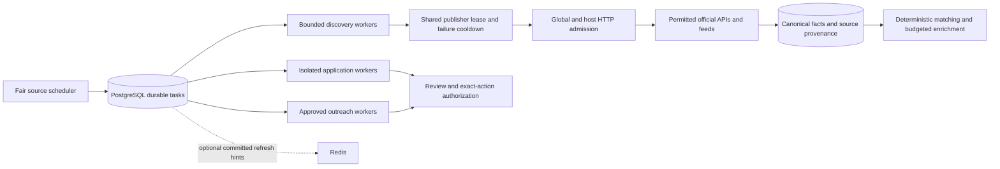

# Phase 5 distributed discovery and automation

## Deployment model

Retain one backend image, PostgreSQL and optional Redis. Launch independent always-on processes using `python -m app.worker`, with `WORKER_KINDS=discovery`, `application`, or `outreach,gmail_sync` to separate resource pools. `WORKER_CONCURRENCY` bounds each process; `BROWSER_CONCURRENCY` stays conservatively capped. PostgreSQL `SKIP LOCKED`, task attempts/leases and shared HTTP budgets coordinate replicas. SQLite is for a local deployment, not multi-host production. Workers run with the laptop off only when deployed to an always-on server; no hosting was performed here.

Redis remains optional for committed UI refresh hints; it does not own task state or concurrency permits. PostgreSQL polling remains correct through Redis loss. Do not add a second broker without measuring admission/claim contention. This change does not replace per-user subscription tasks with a global event fanout scheduler: public network fetches, facts and provider cooldowns are shared, while private matching/bookmark/application state remains isolated.

## Migration and recovery

Back up the database, files and encryption keys using the Phase 4 runbook. Pause writers, run `python -m app.migrate` once, and deploy the same v7-capable image to all API/worker processes. Additive schema v7 introduces only `coordination_state`, `request_leases` and `discovery_health`; no existing column or user data is removed. Both genuine historical v1/v5 upgrade fixtures now expect version 7 and preserve existing encrypted data/references.

A stopped process's HTTP permits expire after the hard HTTP deadline plus 15 seconds. Lost task leases recover only before irreversible upload/submit/send checkpoints. Exhausted attempts stay `failed` as the dead-letter state, and automatic source scheduling excludes them until explicit retry. Uncertain external actions require reconciliation; there is no automatic replay. A physical downgrade restores the verified pre-upgrade backup; do not drop tables or decrement migration history manually. Existing v6 readers can ignore the new tables, but mixed-version workers would bypass the new admission/pause controls, so do not run them together.

## Concurrency, retries and backpressure

- Defaults: 16 global in-flight discovery HTTP requests across PostgreSQL replicas; at most two permits per host. Existing host spacing also serializes local host requests. `HTTP_REQUEST_TIMEOUT=30` is a hard entire-stream deadline, separate from socket timeout. Release runs on success, failure and cancellation; a killed process relies on permit expiry.
- `HTTP_HOST_POLICIES={"api.example.com":{"concurrency":1,"min_interval":2}}` lowers concurrency/increases spacing. Source refresh intervals and reviewed publisher minimum intervals still apply. Robots delays remain enforced for applicable pages/feeds. Robots fetches consume the same HTTP budgets. No CAPTCHA, login or access restrictions are bypassed.
- Existing PostgreSQL host rate reservations enforce shared spacing and server cooldowns. HTTP 429/503 honor integer/date `Retry-After`; no inline retry storm is introduced. Source failures open persisted backoff windows with bounded exponential jitter. Shared publisher subscribers observe the same failure cooldown rather than independently hitting a failed source. Authorization denials are deferred at least a day.
- Network discovery has a 120-second scan deadline, and optional enrichment has a 30-second deadline. Shared publication is fenced by its 180-second publisher lease; an expired/replaced token cannot publish. There is no public-lease extension: long scans defer/restart conservatively.
- `QUEUE_MAX_PENDING=10000` and `QUEUE_OWNER_PENDING=2000` bound queued/running tasks. Admission serializes a short database check; queued duplicates reuse their existing task without consuming capacity. API admission failures return 503 + Retry-After. Schedulers stop admitting a batch at capacity without deleting work or advancing unscheduled sources. Per-owner last-dispatch state rotates task owners, with priority retained within an owner. Source scheduling retains existing owner/volume fairness.
- Task heartbeat renewal and periodic maintenance run outside the event loop. Worker attempts fence discovery, application and outreach checkpoints, including reuse of the same worker ID. PostgreSQL remains the authority; host clocks must be synchronized.

## Pagination and correctness

Existing Greenhouse/Lever/Ashby APIs and supported feeds remain in place. Workday now reads up to four listing pages per run. A durable successful-page offset is saved outside network transactions, under source-generation/task/publisher fences. Every run checks page zero for newly posted jobs, then resumes the bounded rolling window. A failure retains the exact failed offset and bounded successful-page payloads. A crash before ingestion replays those pending rows; pending rows clear only in the final facts/checkpoint transaction. Resumed offset inventories and partial/malformed responses never prove closure. Offset APIs can shift during enumeration: duplicate identities are deduplicated, but snapshot consistency cannot be promised. A new cycle revisits earlier offsets.

SmartRecruiters still performs its existing bounded detail retrieval; complete-board pagination/detail coverage is not added by this phase. No unsupported connector or submission integration is claimed functional. Conditional validators and unchanged publisher snapshots are reused. First-discovered timestamps and original posting dates remain distinct; original dates are absent where a provider only supplies updated/created metadata. Source cache `checked_at`, `last_success`, opportunity `last_verified`, verification classification and closing evidence preserve provenance. Closing by absence now records the complete-inventory source ID and check timestamp. A cached subscriber cannot manufacture a fresh provider verification.

## Matching and outbound safety

Deterministic eligibility remains authoritative. Private profile-ineligible jobs skip model calls. Shared public extraction is profile-independent. Cached shared results skip enrichment. `LLM_SCAN_JOB_LIMIT=50` bounds per-scan candidates; `LLM_DAILY_REQUEST_LIMIT=200` bounds fresh inference reservations globally per UTC day, including failed requests. Set either to zero to disable that work. Budget/DB errors fail closed for model calls while deterministic discovery remains available. This is a request-count cap, not a measured currency/token cost forecast; choose provider limits accordingly.

Application prepare/review/upload/submit authorization, immutable action digests, truthful facts, CAPTCHA/MFA handoff and confirmation requirements remain intact. Queue failure recovery never retries a persisted outbound checkpoint. Gmail still requires specific approval, verified recipient eligibility, rate/gap/daily quotas, suppression, bounce/opt-out/stop-on-reply handling and provider receipts. No outreach was sent during these tests.

## Operational APIs

All require the existing authenticated session and CSRF rules for writes.

- `GET /api/dashboard`: its existing `worker` object includes worker presence, tenant task counts and shared pause state.
- `GET /api/owner/workers/control`: workspace-owner-only pause state.
- `POST /api/owner/workers/control`: `{current_password,purpose,consent,paused,paused_kinds}`. Uses existing fresh owner authentication, purpose/audit and explicit consent. Supported kinds: discovery, application, outreach, gmail_sync. Pause stops new claims; in-flight work drains. Use existing per-user emergency stop for account action revocation.
- `GET /api/sources/{source_id}/diagnostics`: owner-scoped source state, shared/private flag, next permitted attempt, consecutive failure count and bounded checkpoint metadata. No other user's profile or credentials are exposed.
- `POST /api/tasks/{task_id}/requeue`: owner-scoped explicit retry of a failed discovery/Gmail read-sync task only. Applications/outreach use their existing reviewed workflows; arbitrary send/submit tasks cannot be revived here.

## Verification and limits

Run `cd backend && .venv/bin/ruff check app tests` and the complete pytest suite. Set `PHASE4_POSTGRES_URL` to a disposable PostgreSQL database to execute PG variants. New tests create/drop only random schemas. `tests/test_distributed_discovery.py` covers shared-source cooldowns, queue overload, pause/recovery, duplicate execution, attempt fencing, concurrent HTTP permits/expiry, owner fairness, inference budget and failed-page checkpoint recovery. Its 1,000-source scenario uses real feed parsing and request handling over `httpx.MockTransport` (no sockets), bounded consumers and a 32-item fixture queue. It asserts peak HTTP activity against the configured budget. This is simulated failure/correctness evidence, not live throughput or cloud capacity certification.

Remaining costs/bottlenecks: PostgreSQL admission writes serialize briefly per HTTP request and queue admission batch; no independently measured cluster throughput target is claimed. Some discovery ingestion/scoring still uses synchronous SQLAlchemy in async service paths. Existing global adaptive task capacity remains conservative after source errors. Per-user subscription fanout, v1 personalized history scans, complete SmartRecruiters coverage, token-based AI accounting, object-storage isolation and multi-hour failover/soak tests remain later work. Controlled fixture throughput excludes TLS, real provider latency/rate limits, network/disk and cloud failures.
