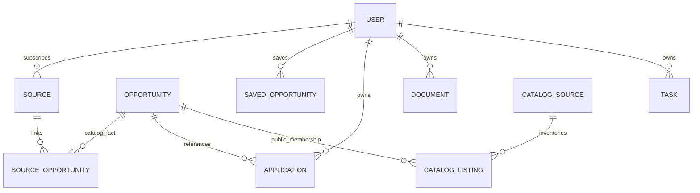

# Technical portfolio and interview walkthrough

## Project description

InternPilot AI is a full-stack opportunity-discovery and application-management project using Next.js/TypeScript, FastAPI, PostgreSQL, Redis hints and Playwright. It separates shared public opportunities from private candidate/application state, applies evidence-backed eligibility rules, and coordinates bounded discovery and approval-based outbound work through durable leases and checkpoints. Its strongest evidence is explicit failure handling and reproducible measurements—including a rejected optimization and an honest million-record latency limitation.

The [read-only public introduction/demo](https://internpilot-ai-notebook.antigravityfree101.chatgpt.site) is deployed and HTTP-verified. Do not describe the account/backend service as deployed, used by thousands, affiliated with a target employer, or generally capable of automated real-world submissions. Provider access and production security gates remain open. [Launch evidence and local mobile screenshots](PHASE9_LAUNCH.md).

## Three resume bullet options

Choose the version matching the role; do not concatenate them into invented independent deployments.

1. Built a Next.js/FastAPI opportunity platform with a shared PostgreSQL catalog and tenant-scoped candidate workflows; validated migration, authorization and recovery behavior with **556 backend tests**, including **28 PostgreSQL variants**.
2. Optimized canonical catalog membership reads and removed redundant joins; reduced same-schema median query time by **30.4% at 100k** and **24.4% at 1M synthetic global records**, while documenting concurrent-load bottlenecks and preserving legacy IDs.
3. Implemented durable task leases, bounded discovery budgets and approval/checkpoint safeguards; verified **1,000 synthetic queued read tasks** completed uniquely with lease recovery, plus **20 browser workflow checks** and an authenticated encrypted database restore.

For a future deployment use placeholders until measured: `[active users]`, `[sustained requests/s]`, `[provider ingestion latency]`, `[monthly spend]`. Never replace the measured 1M p95 of 11.74s with an intended SLO.

## Schema overview

Relationships above describe logical ownership; not every historical reference has an enforced foreign key. Profiles, tokens and document contents are encrypted. Canonical aliases preserve old opportunity IDs; personal scores/saves/actions are not public facts. Schema v7 uses the existing numbered migration runner, not Alembic. Cursor queries bind account, filters and snapshot cutoff; v1 advanced reads retain compatibility costs.

## Ten-minute interview walkthrough

1. **Problem and boundaries (1m):** India/local/international discovery, uncertain eligibility, unsupported providers. Show a source label and review state; explain why a match score cannot authorize a fabricated answer.
2. **Architecture (2m):** walk README diagram; justify PostgreSQL authoritative tasks and optional Redis hints. One backend image with roles simplifies operations; Kafka/Kubernetes would add cost without evidence.
3. **Data correctness (2m):** explain canonical facts versus private memberships, transactional upserts/uniqueness, stable legacy aliases and expand/backfill/index migration order. Discuss missing independent RLS/constraint defense candidly.
4. **Reliability (2m):** lease/attempt fencing, heartbeat expiry, idempotency and pause/backpressure. Distinguish queue exactly-once intent from external side effects: persist a checkpoint, hold ambiguous results, reconcile receipts instead of replaying.
5. **Performance (2m):** show reproduction commands and raw reports; 20 users/1,000 disabled sources/compact fixtures; seven alternating query trials versus short closed HTTP workloads. Explain why the OR rewrite was rejected despite correctness tests. State that 25 clients at 1M reached p95 11.74s and is not a scale success.
6. **Security and next steps (1m):** shared auth budgets, factual documents, short-lived parser limits and explicit action approvals. Explain DNS preflight versus socket binding and process limits versus a complete OS sandbox. Prioritize those boundaries and bounded match/summary reads before adding features.

Demo in an isolated local test account: signup → verify profile → labeled local opportunities → search/filter/save → PDF generation → assisted draft → approval → local test endpoint confirmation → duplicate/restart checks. Live discovery, when permitted, is a separate low-rate source check; the fixture feed is not a live internship claim. Use screenshots under `artifacts/phase7-ui/`, all synthetic. Cite SECURITY_REVIEW and PERFORMANCE_REPORT when asked what remains unfinished.
