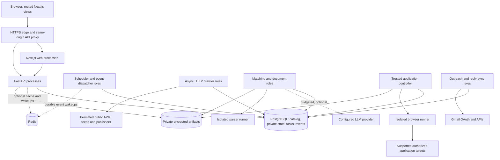
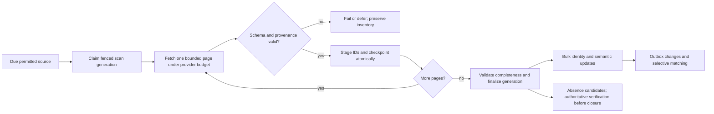
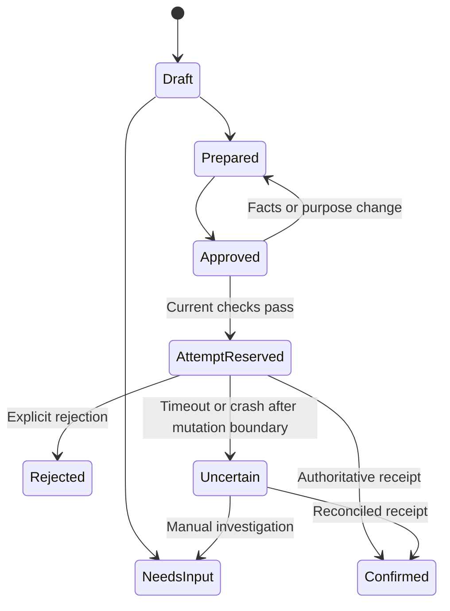

# InternPilot-AI: practical production architecture

Design date: 2026-10-28. Status: **proposed design, not an implemented or benchmarked system**. Companion evidence: [engineering audit](ENGINEERING_AUDIT.md), especially F01–F22. Application code is unchanged by this design task.

## 1. Decision and constraints

Retain a modular Next.js + FastAPI application, PostgreSQL as the transactional store **and durable queue**, existing HTTP/Playwright adapters, optional Redis, and Docker process roles. Share public discovery across users; keep personal state private. Scale HTTP, matching, browser and outreach processes independently from the same backend image. These are process roles in one application, not independently deployed domain microservices.

The first production milestone is correctness under duplicate delivery, partial inventories, expired leases and uncertain external outcomes. The second is measured bounded resource use. A thousand configured sources is primarily a scheduling/provider-budget problem; it is not justification for a thousand browsers, Kafka, Kubernetes or a vector database.

Non-negotiable invariants:

1. Public catalog entries contain permitted public opportunity facts, never candidate profiles, private-feed content, credentials, signed document URLs or browser state.
2. Partial, malformed, reference-only or stale scans cannot authoritatively close a listing. A stale worker cannot commit authoritative results.
3. A shared crawl cannot filter out a listing merely because one subscribing user is ineligible. User eligibility belongs downstream of ingestion.
4. Private reads and writes require owner authorization, including background tasks, caches, downloads and realtime events.
5. Prepared, approved, attempted, provider-accepted and confirmed are distinct states. An ambiguous outcome is not automatically retried.
6. Every outbound action uses the applicable explicit approval and current facts. Existing specific-message and upload/submit consent remains authoritative; this architecture does not broaden consent.
7. Catalog freshness, matching freshness and provider outages are observable. Unknown facts remain unknown; scores are explainable heuristics.

### Evidence and repository fit

| Existing implementation | Design action | Audit |
| --- | --- | --- |
| `models.py:134–169`: owner-specific sources, JSON opportunities and source links | Add public/private catalog scope, typed read model, generations, aliases and subscriptions; migrate additively | F06/F08/F09/F14 |
| `services.py:273–404`: discovery and closure transaction | Separate listing inventory from details; fence checkpoints and finalization; batch writes | F01/F02/F03/F09 |
| `worker.py:65,104,157,171,184,265`: recovery/scheduling/claims/heartbeats | Retain DB queue; add attempt epochs, bounded scheduling, role health, async DB boundaries | F03/F05/F13/F17/F18 |
| `rate_limits.py:14–54`: shared PostgreSQL host reservation | Extend into provider/origin/source admission with leased concurrency; do not replace it with an unrelated Redis limiter | F11/F18 |
| `opportunity_query.py:135–181`, `main.py:779–794` | Replace full scans with indexed queries, versioned matches and bounded aggregates | F06 |
| `llm.py:139–191`, `matching.py:98–223` | Retain conservative rules; move optional model work out of the inventory commit path; shared singleflight | F16 |
| `automation.py:159–175,309–317`, `services.py:463–648` | Preserve guards; expose real adapter capabilities and usable manual handoff | F19 |
| `outreach.py:123–155,234–247`, `gmail.py:115–138` | Exact-thread synchronization, bounded history cursors and lock-free network waits | F04/F05/F13 |
| `page.tsx:81–135` | Shared authenticated layout, view-specific queries, targeted invalidation and normal routes | F07/F20/F22 |
| `migrate.py:11–63`, cloud Compose, existing encryption/password functions | Keep compatibility; introduce explicit migration jobs, scoped credentials and tested restores | F12/F14/F15/F21 |

## 2. Workload assumptions and capacity arithmetic

These are planning inputs and proposed targets, not measurements. “Active user” must distinguish daily active users (DAU), concurrent browser sessions and connected Gmail senders. Source count below means unique scheduled source identities after deduplication, not user subscriptions. Default throughput estimates assume public HTTP APIs/feeds, not browser-rendered discovery.

| Input | Solo | Growth | Planning envelope |
| --- | --- | --- | --- |
| DAU / peak concurrent sessions | 1 / 2 | 500 / 100 | 5,000 / 500 |
| Unique configured sources | 100 | 1,000 | 1,500 |
| Nominal interval, if provider permits | 30 min | 15 min | 15 min |
| Mean HTTP requests per scan | 2 | 3 | 3 |
| Nominal scans/day | 4,800 | 96,000 | 144,000 |
| Nominal HTTP requests/day | 9,600 | 288,000 | 432,000 |
| Mean request rate | 0.111/s | 3.333/s | 5/s |
| Assumed mean HTTP service time | 2 s | 2 s | 2 s |
| Mean occupied HTTP slots, including 20% overhead | 0.27 | 8 | 12 |
| Initial global HTTP slot ceiling | 2–4 | 16 | 24–32 |

Arithmetic: `requests/day = sources × 86,400 / interval_seconds × requests_per_scan`. Required occupied slots are approximately `request_rate × mean_service_seconds`; multiplying by 1.2 is a planning allowance, not a measured retry rate. At five seconds mean latency instead of two, the last tier needs about 30 occupied slots before headroom. A few boards can need tens/hundreds of paginated/detail requests; measure the request distribution and account for those separately instead of trusting the average of three.

**The restrictive host determines feasibility.** For each provider budget h:

`sum(requests_per_scan_i / interval_i) <= 0.7 × min(allowed_requests_per_second_h, permitted_concurrency_h / mean_service_seconds_h)`

At one request/second, three requests/scan and a 30-minute interval, this allows approximately **420 sources**, with 30% headroom, assuming permitted concurrency also supports that rate (at least two slots at two-second mean service time). If concurrency is limited to one slot, the same two-second service time halves effective capacity to about 210 sources. If 1,200 boards share the one-request/second provider, 15–30 minute refresh for all boards is infeasible. With adequate permitted concurrency, their equal-share period is at least `1,200 × 3 / 0.7 = 5,143 seconds`, about 86 minutes; one permitted slot at two seconds doubles that bound. Support explicit freshness tiers, authorized bulk endpoints and longer intervals; show the effective schedule to users. Do not evade limits with alternate hosts/proxies or treat every ATS tenant as an independent allowance without provider permission.

Additional envelope assumptions:

- 1 million retained catalog opportunities, about 100k open/recent; 2,000 new or materially changed records/day after normalization. A different change rate directly changes matching/LLM costs.
- 500 concurrent sessions, each making one user-driven API interaction per 20 seconds: about 25 API requests/second before retries/pagination. SSE invalidates active resources; it must not recreate the current nine-request polling bundle.
- 2,000 changed opportunities × 1,000 candidate users after coarse routing = 2 million deterministic pair evaluations/day, about 23/s average. At ten times the change rate this is 231/s; benchmark rule evaluation and database writes rather than assuming either is free. Admission/notification caps bound worst-case bursts.
- Never materialize 5,000 × 1 million = **5 billion** match rows. Retaining the best 500 current evaluations/user is **2.5 million** rows, plus separately budgeted saved/application evaluations and compact ranking-generation projections. Exact on-demand checks for viewed/saved/applying records remain available.
- Gmail is optional. Five thousand connected senders polled every 15 minutes produce **480,000 minimum history requests/day**, before thread/message fetches. Five thousand users are not assumed to send 40 emails/day; that would be 200,000 daily messages and requires a different operational/deliverability assessment.

**Write/byte amplification is a separate capacity dimension.** At 144,000 scans/day and 1,000 listings/scan, naively rewriting every sighting would create **144 million membership updates/day**, even with only 2,000 semantic changes. The design below reuses immutable unchanged inventories and updates source-level verification, rather than touching every listing. Benchmark changed-inventory reconciliation, WAL, index churn and vacuum explicitly. If average HTTP payload is 100 KiB, 432,000 requests/day transfer roughly 44 GB/day (about 1.3 TB/month) into the crawler; at 1 MiB it approaches 453 GB/day. Conditional requests reduce bytes only where providers support them. Parsing and paid proxy/egress costs can dominate an apparently small request rate; measure payload distributions.

**Browser capacity is independently limited.** Required slots approximately equal `attempts/day × mean_attempt_seconds / (86,400 × target_utilization)`, with additional peak-window provisioning. At 1,000 preparation attempts/day, 120 seconds/attempt and 70% utilization, approximately two all-day slots are required. If 80% arrive during eight hours, that window needs about five slots. Initial 1–2 slots are therefore a quota-limited preparation service, not a promise of auto-application capacity for 5,000 users. External final-submit capacity remains zero until an adapter is certified. Any interactive handoff also needs a separate idle timeout, session TTL and slot budget.

## 3. Runtime and boundaries

At solo scale trusted web/API/scheduler/matcher/controller roles can run in one supervised container on a VM, subject to separate concurrency limits and a memory reserve. Untrusted browser and parser execution runs in separate constrained containers/sandboxes, even on the same VM: different UID, no host PID namespace, Docker socket, database credentials, global decryption keys or unrelated secret/artifact mounts. Different environment variables in processes sharing one UID/container are not a security boundary. At growth scale extend the existing `deploy/compose.cloud.yaml` role split. The scheduler/event dispatcher can share a lightweight process; matching and outreach may share a host with separate process/resource budgets.

The application/browser controller retains the narrow DB privileges needed to reserve/finalize approved work. The sandbox runner receives an authenticated task envelope with attempt epoch, allowed destination, verified fields and purpose-specific short-lived artifact capabilities; it returns structured evidence. It cannot query arbitrary profiles or decrypt the database. Internal claim/result endpoints are limited to the runner role and assigned task, with fleet quotas; untrusted page requests cannot access that control channel. Parsers receive only the assigned input and an output channel with no general egress. Reset runner storage/context between users. This is an execution sandbox within the same application/image, not a general remote-browser service. Platform support for this boundary must be tested; unsupported isolation disables that capability.

**Database I/O choice:** retain SQLAlchemy and installed psycopg 3. New async worker/realtime paths use SQLAlchemy's async engine with psycopg; existing synchronous FastAPI `def` routes can remain temporarily on a bounded synchronous pool. Never call a synchronous session from an async loop and never share sessions across tasks. Avoid a simultaneous conversion of every endpoint. Count both pools in the connection budget; retire the legacy engine as its last caller migrates. CPU-heavy parsing/PDF work uses a bounded process with memory/time limits, not an unbounded thread queue.

No connection remains checked out while waiting on an HTTP provider, browser, token refresh, SSE client or a rate-limit timer. Reserve state in a short transaction, perform bounded I/O, then conditionally finalize in a second transaction.

## 4. Shared catalog and private data model

### Ownership model

Use one explicit public catalog scope and isolated private scopes. A stable source identity is `(scope_id, connector_kind, normalized_endpoint_and_parameters, credential_principal_if_applicable)`. Mutable access-policy versions are separate fenced state; a permission edit must not create a second logical source or split inventory history. Only reviewed permitted public sources can enter the global scope. A user's checkbox confirms their configured access method; it is not sufficient authority to redistribute an arbitrary private/authenticated feed globally. Keep custom/private sources private until promotion is explicitly reviewed. Pausing one user's subscription cannot stop a global source used by other subscribers.

The catalog tables carry `scope_id` and a stable scope foreign key; the public scope has no owner, private scopes have exactly one owner. Unique constraints include scope. Private catalog rows must never appear in public cache/search indexes or global metrics. Sharing a connector or physical table is not sharing its private results. Do not deduplicate a private requisition into public visibility just because its URL resembles a public record.

### Proposed schema, added alongside existing tables

| Table / group | Core fields and invariants |
| --- | --- |
| `catalog_scopes` | Stable ID, kind public/private, nullable owner FK; check constraints on owner/kind and exactly one public scope. |
| `catalog_sources` | Scope, connector, normalized identity hash, permitted-method evidence/review state, policy version, enabled, desired/effective interval, next_due_at, generation, active_scan_id, last complete scan, circuit state. Unique scoped source identity. No user refresh preferences or provider secrets in shared config. |
| `source_subscriptions` | `(owner_id, source_id)` PK, enabled, user preferences, created_at. Authorization validates source scope. Source crawl priority uses bounded aggregate demand, not one task per subscriber. |
| `source_scans` / `scan_pages` | Scan ID/generation, source, connector/schema version, snapshot/cursor, request counts, status, completeness proof, started/finished, body hash, checkpoint and immutable inventory revision reference. Unique page key within a scan. Page data is staged until validated. |
| `source_listings` | `(source_id, provider_listing_key)` PK, canonical opportunity FK, membership revision, explicit positive/closure evidence and absence candidate. Immutable complete inventory revisions reference membership/deltas; unchanged scans advance source verification without rewriting all memberships. Inventory membership is independent of downloaded description details. |
| `catalog_opportunities` | Stable UUID compatible with existing ID shape; scope, organization, kind internship/hackathon/program, title, primary verified application URL, status/evidence, first_seen, published_at nullable, last_positive_verification, current_version, material_hash. Facts have provenance; unknown is not false/zero. |
| `opportunity_versions` | Immutable semantic versions: normalized facts, description, quoted eligibility evidence, source provenance, extractor version, content hash, observed_at. Repeated fetch timestamps do not create a new semantic version. Retain bounded history subject to source policy. |
| `opportunity_aliases` / `requisition_keys` | Scoped provider/employer/requisition identities and URL aliases with evidence; unique scoped identity. Canonical merge redirects preserve old IDs. Alias ambiguity is reviewable. |
| `opportunity_locations` / `opportunity_skills` | Typed country/region/city, remote scope (India/global/restricted/unknown), normalized skill IDs; join indexes. Multi-location roles are not flattened into one misleading string. |
| `profiles`, `profile_versions` | Owner FK, monotonically increasing profile version, encrypted facts and original verification/attestation provenance. Encrypted contacts, project text and resume; no catalog visibility. |
| `profile_routes` | Private coarse country/degree/grad-year/topic routing metadata only, versioned and access controlled. This is private data, not anonymized data. If policy requires encryption of all routing fields, omit these indexes and batch-decrypt/filter the 5k-user routing set in an isolated matcher; do not invent custom searchable encryption. |
| `user_matches` | `(owner_id, opportunity_id)` PK, opportunity/profile/rules versions, eligibility enum, score 0–100, reasons/missing facts, evaluated_at, expiry of time-dependent ranking. Index current top matches. Stale versions cannot authorize an action. |
| `recommendation_generations` / `recommendation_items` | Owner/profile/rules version, catalog cutoff and coverage, generation state; compact ordered top-N opportunity/version/score items. Publish one generation atomically after building it; retain current + one prior bounded generation for cursor TTL. This is separate from the mutable current-evaluation cache. |
| Saved/tracker state | Preserve existing IDs/history; owner-scoped saved records, notes, manual statuses. References authorize public or the user's own private catalog scope. |
| `owner_action_targets`, `application_intents`, `application_attempts`, approvals | Private per-owner action identity resolves trusted provider/employer/requisition keys across that owner's visible public/private scopes without merging catalog visibility. Unique owner/action-target intent, multiple immutable preparation/submission attempts, pinned document/profile/opportunity/question/adapter versions, purpose-specific approval hashes, receipts and uncertain states. Ambiguous cross-scope identity blocks automation; legacy duplicate histories remain auditable. |
| Documents/artifacts | Existing encrypted document metadata/IDs; atomic per-scope version counter and unique version constraint with explicit NULL scope handling. Object key, checksum, encryption key ID, retention and upload state when offloading blobs. |
| Outreach/contact/provider state | Existing private tables plus per-thread history cursors, per-sender reservations, contact suppression and immutable send attempts. Contact dedupe uses normalized recipient identity within an owner. No public recruiter-contact warehouse. |
| `tasks`, `task_attempts` | Typed kind/resource/scope, immutable intent key, small ID-only payload, available_at, leased attempt epoch/owner/expiry, attempt history, retry reason. State checks and partial claim indexes. |
| `domain_budgets`, `domain_permits` | Provider/origin/source keys, interval/quota/cooldown state, policy version; leased in-flight permit, request deadline. One authoritative admission system. |
| `outbox_events`, `user_change_log`, `consumer_checkpoints` | Durable versioned domain events, unique event/consumer processing markers, per-user monotonic replay cursor, bounded retention. No encrypted resume/body in event payload. |
| `worker_heartbeats`, audit/quotas | Actual roles/build/host/capacity, DB-clock freshness, per-kind progress, immutable private action audit and hard quota reservations. |

Use `TIMESTAMPTZ` for instants, UTC in API transport, and IANA timezone + date precision for deadlines/quiet hours. If a publisher provides only a date with no timezone, retain the date and unknown timezone rather than manufacturing a precise cutoff. Display uncertainty; do not authorize an approaching-deadline action from an invented instant. Store compensation/prizes as structured amount/currency/period/range plus source text; an international stipend cannot be sorted as INR without dated exchange-rate policy. Keep hackathon start/end separate from registration deadlines.

Keep typed high-selectivity columns and normalized relationships for search/filter/sort; use JSONB for evidence and connector-specific extras. Distinguish `last_fetched`, `inventory_confirmed_at`, `content_verified_at` and `application_url_verified_at`. A 304 for a reference feed cannot refresh official application verification. Expired records are filtered by time on read as well as updated by scheduled jobs, so a delayed expiry worker cannot make them appear open.

### Database enforcement and access

- Add foreign keys and composite tenant references after orphan checks. For owner-private relationships use `(owner_id, id)` references, not only an opaque ID. For catalog references enforce the allowed public/private scope through RLS and validated write paths; a plain FK to a catalog ID does not establish access rights.
- API role: public catalog SELECT, private owner-scoped operations, no source-permission escalation. Crawler role: allowed catalog/source/budget/task operations, no private profiles/documents/OAuth keys. Matcher: limited profile/match fields. Browser/outreach: narrow task and artifact/provider privileges. Migrator is a separate role.
- PostgreSQL RLS is defense in depth on private and scoped catalog tables. Set owner context using transaction-local settings, never client-supplied owner parameters; pooled connections must not retain context. Worker roles are narrowly explicit; do not grant the normal API `BYPASSRLS` or run it as table owner. FORCE RLS where appropriate. Integration-test policies and cross-table checks under actual connection pooling.
- Public crawl tasks need a catalog-scope/resource identity rather than a synthetic “system user” owning all public data. Migrate current mandatory `Task.owner_id` to explicit public/private scope with check constraints; legacy private tasks keep their owner.

## 5. Canonical identity, ingestion and closure correctness

Identity priority: verified provider + employer + stable requisition ID, then authoritative URL aliases. A normalized URL is fallback identity. Company/title similarity alone never merges roles, seasonal requisitions or hackathon editions. A renamed organization/domain is an explicit alias migration. Catalog identity operations remain inside scope. Separately, an owner's private action-target resolver can recognize the same trusted requisition across scopes they may access; this prevents duplicate applications without revealing private content or aliases to anyone else.

Connector contracts return: connector/schema version, scope/source, page/snapshot identity, listing IDs, normalized records, provenance, continuation, completeness enum and explicit close evidence. Completeness is `reference_only`, `partial`, `complete_snapshot` or `unknown`; it is never inferred from an HTTP 200, default empty array or a low total count. A detail budget of 20 limits details, not inventory coverage. List every ID from validated listing pages even when its details must wait.

For each scan:

1. A new inventory scan increments the source generation once. Its retries, page continuations and recovered claims retain that scan ID/generation; each task claim/reassignment increments a separate attempt epoch. Abandoning an invalid snapshot and starting new coverage creates a new generation. Use a fixed lock order; no overlapping authoritative inventory for the same source. Check fresh database time after acquiring locks (for PostgreSQL, `clock_timestamp()`, not transaction-start `now()`) at the conditional checkpoint/finalization boundary.
2. Fetch/parse outside transactions. Long rate waits set `available_at` and release the worker; they do not occupy an HTTP slot. Protect response bytes, decompression, CPU and deadline budgets.
3. Stage a page in a short transaction keyed by scan/page; checkpoint and task continuation commit atomically. Every stage/finalize verifies current task attempt epoch, unexpired lease, active source generation and permission version. Reapers/claimers use the same lock order so they cannot transfer ownership halfway through an accepted checkpoint. Validated positive observations/details can publish in fenced per-page batches without waiting for the entire board; only absence/closure authority waits for completeness.
4. Bulk upsert normalized batches, initially 200–500 records, tunable by payload and transaction-time measurements. Use `ON CONFLICT` and `IS DISTINCT FROM material_hash` to avoid rewriting unchanged rows. Return changed IDs only. For a 304 or unchanged validated full-inventory hash, reference the prior immutable inventory revision and update source-level verification; derive its members' inventory freshness by joining that revision. Do not rewrite every membership/verification timestamp. For changed inventories stage bounded ID/page deltas and reconcile them against the prior revision; compact delta chains under a bounded retention policy. Content verification is still separate. Use `COPY` into staging for large imports only when measured batch INSERT cost warrants it.
5. Finalize completeness only if every expected page is validated, all continuations exhausted and the connector's snapshot guarantee is satisfied. On a changed/expired snapshot, restart inventory coverage; do not combine inconsistent offsets into a fictitious complete snapshot.
6. Each batch atomically commits semantic changes, checkpoint and outbox events. Publish the complete-inventory marker in a small transaction; run any absence/closure reconciliation in resumable fenced batches against that immutable revision, never one huge final transaction. Consumers see only committed versions. An out-of-order detail response cannot replace newer evidence: compare source generation/detail revision and provenance authority.

Offset pagination without stable snapshots can miss or repeat rows during reordering. Therefore absence from such a traversal is an **absence candidate**, not immediate proof of closure. Require repeated complete observations plus an authoritative detail/status check, or a documented provider snapshot/explicit closed signal. If that proof is unavailable, label stale/unverified and suppress confident-open presentation. A transient 404 is rechecked under connector policy; 403/429/timeout is never closure. Canonical closure requires all relevant authoritative positive evidence to be superseded; a reference feed can neither close an official record nor reopen one against newer official closure.

A source deletion/subscription removal does not destroy shared records. It changes visibility/subscription interest, and its source evidence becomes disabled/unavailable without rewriting unrelated source facts. Private application/saved history stays accessible through authorized historical snapshots even when a source is removed. Source policy revocation invalidates in-flight writes and future scheduled fetches.

## 6. Crawling, schedules and bounded admission

Initial HTTP execution: one reusable `httpx.AsyncClient` per process/policy group with bounded connections and keepalive, 8 HTTP slots/process at growth, 16–32 total only after measurements. Start with a 2-MiB ordinary decoded response budget; sources requiring the existing 12-MiB bound need explicit connector overrides and fewer simultaneous large responses. Bound compressed and expanded bytes, request wall time and parsing memory: multiple decoded/string/JSON copies can use several times the response size. Defer expensive parsing to a bounded runner rather than stalling lease heartbeats. HTTP/2 is optional when supported, with stream concurrency counted in the same provider budget. Playwright is never the default discovery transport. Add a browser discovery adapter only for a permitted, measurable source that cannot use static public access.

Budget hierarchy: provider-wide policy → origin → source/credential scope. A shared ATS API budget covers its boards unless documented allowances explicitly differ. A robots crawl-delay or publisher-specific restriction can be stricter. Lock budget keys in deterministic order. Unknown source defaults: one concurrent request/origin, one request/second or slower; these are conservative defaults, **not proof of site permission**. Record robots/terms/access review state, cache robots with validators/expiry, and halt on denied/unknown policy according to the approved connector. Never bypass login/CAPTCHA/anti-bot controls.

At the planned 4–6 requests/second including overhead, PostgreSQL budget rows/permit leases are adequate in principle and retain the repository's current authority. Rate admission and a limited-duration in-flight permit commit in a short transaction before request I/O. Permit TTL exceeds the hard HTTP timeout plus cancellation margin. Release on completion; crashes expire permits only after that deadline. A timeout can leave server-side work continuing, so assume no right to burst immediately afterward. Do not maintain an independent Redis rate limiter that disagrees with PostgreSQL. Consider Redis Lua admission only after sustained admission rate/lock latency demonstrates a bottleneck; that change needs explicit crash/restart/fail-closed semantics and one authority at a time.

Proposed defaults, subject to source policy and tests:

- Scheduler tick 5–15 seconds, stable source-ID jitter ±10%; enqueue at most 200 due resources/transaction. Multiple schedulers use SKIP LOCKED; no exclusive leader is required for correctness.
- Source classes: active high-value permitted APIs 15–30 min; low-change sources 1–6 h; dormant sources 12–24 h; explicit calendar feeds on their permitted cadence. Manual refresh requests coalesce and honor cooldown.
- Adaptive interval uses observed material-change rate, near deadlines, enabled subscriber demand and source health, with hard policy minimum/maximum. A high subscriber count cannot exceed a provider budget. Unknown/new/small sources retain a minimum fair share so historical popularity does not starve them.
- Retry retryable read failures with full-jitter exponential delays; honor the full Retry-After (including HTTP dates). Example maximum five attempts per scan over a bounded horizon, then failed/deferred. 401/403/schema/policy errors pause or require review rather than loop indefinitely. Retry admission is budgeted traffic.
- Per-provider breaker: open after a measured failure threshold (initially five recent failures and >=50% failure ratio), defer for 2–15 min or provider cooldown, then allow one half-open probe. Separate schema/policy failure from network availability. These thresholds need calibration, not fleet-wide application.
- Backpressure caps pending work by kind/resource and estimated queued seconds. Allow at most one pending/running refresh intent per source plus its page continuations. Coalesce redundant match requests to the latest version; preserve immutable send attempts. At capacity defer low-priority scans/optional AI, never discard approvals or critical audit evidence.

Source health includes effective cadence, coverage/completeness, last positive verification, schema version, p50/p95 latency, bytes, changes/request, errors/429s, consecutive failures, retries, next eligible time and coverage lag. Expose public summaries with no URL credentials/private-source names to other users.

## 7. PostgreSQL query and cache design

Initial indexes are driven by actual query shapes, not every possible filter combination:

| Query | Initial index / mechanism |
| --- | --- |
| Recent open catalog by scope/kind | `(scope_id, kind, discovered_at DESC, id DESC)` partial on stable `status='open'`; query deadline/freshness separately. Do not put `now()` in a partial-index predicate. |
| Deadline browsing | `(scope_id, kind, deadline_at, id)` for non-null/open rows; separate unknown deadlines; date-only unknown-zone facts retain separate semantics. |
| Source scheduling | `(next_due_at, id)` partial on enabled/permitted; provider budget policy lookup by key. |
| Inventory reconciliation | `source_listings(source_id, last_seen_generation, provider_listing_key)` and reverse `(opportunity_id, source_id)`. |
| User recommendations | `(owner_id, profile_version, rules_version, score DESC, opportunity_id)` with current-row design; stale filtering joins the current opportunity version. Avoid retaining every historical score in this hot table. |
| User history / notifications | `(owner_id, created_at DESC, id DESC)`; channel-dedupe uniqueness and unread partial indexes where useful. |
| Task claims | Ready tasks separated from delayed tasks; partial `(kind, priority DESC, created_at, id)` on ready state, `(available_at, id)` on delayed state, `(lease_until, id)` on running state. Promote due delayed work in bounded batches. |
| Alias resolution | Unique scoped provider requisition key and unique scoped canonical URL hash, with collision/evidence checks. |
| Search | Weighted PostgreSQL `tsvector` over public title/company/skills/description with GIN; `pg_trgm` for company/title typos only if extension availability and query plans support it. Never include private contact/resume text in public search. |

No read replica or partitioning initially. Add time partitions only when retention/vacuum/index metrics justify them, typically large append-only attempt/event tables; partitioning complicates unique constraints and migrations. For substring/Unicode behavior preserve existing casefold and literal wildcard semantics through explicit contract tests; FTS is a search improvement, not automatically a drop-in replacement for every existing filter.

Use opaque signed keyset cursors containing sort tuple, filters hash, authorized scope, as-of cutoff and ranking/profile version. Newest sort uses `(discovered_at, id)`; deadline sort `(deadline_at, id)`. `published_at` is nullable/untrusted and may be backfilled, so do not silently repurpose it as immutable discovery order. Exact totals are optional cached aggregates, not computed on every page. Return `has_more`, page items and freshness/version metadata.

Concurrent updates make keyset pagination better than offset pagination but not a frozen snapshot. Newest feeds hold an as-of discovery cutoff and show a “new results” control; status/permission changes remain immediately authoritative even if that removes rows. Relevance paging pins a materialized per-user ranking generation; retain one prior bounded generation for short-lived cursors, otherwise return a clear restart response when the generation changes. Never keep a database transaction open across browser page requests.

Redis remains optional for solo deployment and useful for short-lived query caches, shared auth throttling and realtime wakeups. Cache public lists only when the entire result is public. Private keys include owner, profile/rules/ranking versions and filters; authorization occurs before cache lookup. Do not cache decisions to send/submit, OAuth tokens in shared public keys, or stale eligibility as authorization. Initial TTLs: public list 15–60 s, private list/summary 5–15 s, conditional detail ETag based on semantic version. Outbox invalidation shortens staleness; TTL remains a fallback. Stampede control uses per-key singleflight and stale-while-revalidate only for safe read displays. Recheck current source/facts/policy directly for outbound actions.

Connection example for the planning envelope: 2 API processes × pool maximum 10 = 20, 2 crawler processes × 4 = 8, matcher 4, outreach 4, browser 2, scheduler/dispatcher 4 = **42 application connections**; reserve at least 10 more for migrations/admin/monitoring. This is a pool cap, not 42 constantly active queries. Against a 100-connection plan, keep an explicit <=80 budget, include old sync and new async engines, and limit overflow. PgBouncer is a managed/provider option when process count/idle connections warrant it; validate transaction pooling with RLS context and avoid dependence on session-level advisory locks/LISTEN for correctness.

## 8. Distributed task and event semantics

Retain the SQL-backed queue: source changes, work intents and events can commit atomically with application state, and current expected throughput does not justify another durable messaging system. SKIP LOCKED is useful but insufficient without fencing and side-effect design.

- A logical work intent has a stable dedupe key and monotonically increasing requested version; attempts have separate IDs/epochs. Do not reset all history on each reuse as the current `enqueue()` does. Queue payloads contain validated IDs/expected versions, not serialized credentials or resumes.
- Scheduler locks due sources, records a bounded work intent and advances the effective next-due state in the same transaction. Claim increments attempt epoch and records DB-clock lease. Initially 90–180 second task leases, heartbeat at <=one third, with fetch/page/PDF hard deadlines chosen to fit; long scans checkpoint and continue instead of holding an hours-long lease.
- Every authoritative internal effect is idempotent by intent/version, protected by unique constraints and epoch/generation predicates. Check fencing at the write boundary, not merely before network work or at final task acknowledgment. Reapers and writers share a documented lock order. A recovered attempt cannot revive an expired predecessor.
- Retry safe reads/normalization/matching. Do not retry an external mutation merely because the task lease expired. Classify errors as retryable, quota-deferred, policy-paused, permanent, or uncertain-external-outcome.
- Use weighted fair scheduling by kind and tenant within separate resource pools. A provider outage or one user's bulk import must not consume all ready slots. Add priority aging; imminent deadlines raise priority within policy bounds. Heartbeats do not compete behind PDF work or full-catalog scans.
- Limit pending work by unique resource/version rather than accepting arbitrary unbounded task rows. Match batches are keyed by cohort/shard/window and coalesced to the latest needed version; no task-per-user-per-entire-catalog fan-out. Superseded jobs exit cheaply.

The transactional outbox uses a unique event ID, aggregate ID/version, scope, type and small ID-only payload. Domain writes, outbox event and required consumer-delivery intents commit together. Dispatch is at least once. Consumers claim unprocessed delivery rows with leases/SKIP LOCKED, and commit idempotent effects plus a unique processing marker. They must not use a global sequence high-water mark as evidence that all lower event IDs have committed: transactions can commit out of allocation order. Out-of-order events cannot regress an aggregate version. At this size PostgreSQL polling is the replay source; Redis pub/sub is only a wakeup hint. Event retention and consumer lag have an explicit contract; expired replay requires rebuilding current projections. Keep no private body text in public event envelopes.

Per-user durable change-log sequences require a per-owner counter row locked through commit in the same short transaction as the visible private update; this serializes that owner's cursor allocation and commit visibility. A plain database sequence alone is insufficient: event 2 could commit before event 1 and cause a reconnect to skip 1. No network I/O runs under this counter lock. Test reversed-commit concurrency explicitly. Public scope-version invalidations use an equally commit-ordered published projection. A catalog event can invalidate a public scope once, rather than emit 5,000 personal events per sighting. Routine scan heartbeats/unchanged fetches update operational state, not every user's feed. Coalesce high-match/deadline alerts with unique owner/opportunity/event-policy keys and daily caps; in-app delivery is automatic, external delivery retains its explicit approval gate. Global events must never expose private subscriptions or contacts.

Operational telemetry: task wait/runtime/attempts by bounded kind/provider labels, expired leases, stale commits rejected, heartbeat/event-loop lag, pool wait, DB lock/vacuum metrics, source coverage, outbox lag, effective HTTP slots, bytes/request, model usage, private artifact size and uncertain outbound actions. User/source IDs belong in controlled structured logs/traces, not high-cardinality metric labels. Separate liveness, API readiness and per-role progress; an outreach heartbeat cannot declare discovery healthy (audit F17).

## 9. Selective matching and AI

1. Ingest and normalize public facts once, independent of any candidate. Keep opportunity classification broad enough to preserve student programs and hackathons. Publish the catalog version without waiting for an LLM.
2. Route changed records to potentially interested cohorts using country/remote scope, graduation constraints, degree/kind/topic and active-user preferences. Unknown requirements broaden routing; they do not become eligibility. Recompute active users first; inactive users are refreshed on return before presenting an exact current match.
3. Run the existing deterministic extraction/eligibility rules before expensive work. Separate eligibility (`eligible`, `ineligible`, `review`) from relevance score and urgency. Preserve evidence quotes and unsupported mandatory conditions. User-verified facts mean attested by the user unless an external credential was actually checked.
4. Cache evaluations on opportunity material version + profile version + rules version. Keep bounded top recommendations and records the user saved/viewed/applied to. Time-based urgency is calculated cheaply at read time or refreshed on scheduled deadline boundaries without re-extracting descriptions. Never silently label a partial candidate-pool ranking as exhaustive “best of the internet.”
5. Optional LLM extraction is requested only for useful ambiguity on records relevant to at least one active cohort, or for a user-requested explanation/draft. Job-only extraction never sees profiles. A description cache is scoped to public/private catalog, model, prompt/schema version and content hash; private scopes never share descriptions/results across users. Use durable singleflight and a global provider concurrency/token/dollar budget.
6. Model output is untrusted annotation with quoted evidence. Exact quote presence alone does not prove interpretation; structured official facts, validated deterministic extraction or explicit review establishes authority. No model answer can promote unknown work authorization, graduation, grades or achievements into verified facts. Model outages leave deterministic discovery usable.

Profile edits and rules upgrades also trigger recomputation even when listings have not changed. Enqueue one coalesced, version-fenced profile rebuild, retrieve an indexed current candidate pool (initially capped at 2,000 with explicit coverage), evaluate in bounded batches and replenish saved/action-relevant checks. Build then atomically publish a new recommendation generation only if the profile/rules versions remain current. Until complete, show the previous ranking as stale and provide exact on-demand checks; it cannot authorize actions. Shard full active-user rule upgrades and rebuild inactive users on return. This prevents a new skill/location/degree preference from missing unchanged opportunities while bounding work.

For the assumed 2,000 changed records/day, a **budget example**, not a demand forecast: 10% receive model extraction = 200 calls/day. At 2,000 input + 300 output tokens/call, monthly tokens are 12 million input and 1.8 million output. Cost is `12 × input_price_per_million + 1.8 × output_price_per_million`, plus explicitly requested private drafts. Do not quote a fixed dollar amount without a selected provider/model/current quote. Enforce daily ceilings and per-user request limits; when exhausted, queue optional work or display deterministic results, never block inventory commits. Maximum context sizes and prompt-injection controls reduce waste and data exposure.

Version a labeled India/international/2029 eligibility dataset; measure false-eligible rate separately from ranking quality. Include remote-but-country-restricted roles, date-only deadlines, master's-only research programs, contradictory evidence, hackathon student/team rules, preferred versus required skills and new/small employers. A score increase is not proof of better recommendations without this evaluation.

## 10. Applications, outreach and artifacts

### Application state machine and authorization

Manual/Assisted/Authorized Auto modes remain capability-gated. In the audited repository external final submission is unsupported; initially `can_submit=false` for every external adapter and true only for the local authorized test adapter. “Auto” configuration cannot manufacture integration support or remove the latest specific-action approval policy. Any future standing policy needs separately documented activation and scope; no migration activates it automatically.

An approval binds owner, canonical requisition, destination origin/form/adapter version, verified answers/profile version, required question schema, artifact checksums and action purpose (upload versus submit). Deadline/eligibility/consent/source policy must still be current at dispatch. Avoid binding irrelevant fetch timestamps that would invalidate every approval after an unchanged scan. Any material change reverts to review. Sensitive/legal questions, MFA/CAPTCHA/login and unsupported fields always hand off; no guessed answer.

Unique application intent per owner/action-target plus request idempotency tokens prevents duplicate internal attempts, including trusted public/private representations of the same requisition. Before external mutation, commit an immutable attempt reservation and exact approval evidence. Network I/O occurs outside locks; final writes compare attempt epoch/status. Where a provider supports idempotency keys, use a stable action key. Where it does not, **exactly-once external effects cannot be guaranteed**. A timeout/crash after reservation is uncertain even if the request might never have left the process; reconcile conservatively before another attempt. Do not assume a negative receipt search proves nothing was sent.

There is no distributed transaction with an employer/Gmail. An emergency stop prevents unreserved future actions and is checked again at the last practical boundary; it cannot retract a request already accepted by a provider. Track cancellation requested versus confirmed. Status “submitted” requires an authoritative confirmation/requisition receipt, not a screenshot, filled DOM or worker exit code.

External assistance initially provides a useful typed answer package, verified document download and official URL. Be explicit that a closed headless context does not hand filled fields into the user's normal browser. Add a tightly scoped interactive browser handoff only if permissions, resource costs and operational support justify it. Uploaded file selection, upload completion and form submission get separate evidence states.

### Gmail and outreach

- Reuse OAuth integration, minimum required scopes, encrypted refresh tokens and provider sender identity. Never scrape/invent recruiter contacts or infer deliverability from a guessed address. Preserve per-message approval and factual templates; no automatically sent follow-ups by default.
- Serialize sender quota/gap reservations in a short transaction, enforcing user daily limit (configurable maximum 30–40 if allowed), provider quota, quiet hours, suppression and global abuse budget. No DB lock is held while refreshing OAuth tokens or sending.
- Token refresh obtains a leased per-connection reservation, performs the refresh outside DB locks and stores with a compare-and-swap version. Token responses are not logged. Revocation moves the connection to reauthorization rather than indefinite retries.
- Before a follow-up, fetch the **exact thread** and process all unprocessed messages using a durable cursor. A failed or stale check blocks send. Check known recipient suppression again during reservation and immediately before dispatch. A reply arriving between the final check and the actual provider send is an unavoidable cross-system race; promise suppression for observed replies and halt subsequent work, not impossible atomic Gmail+database consistency.
- Use Gmail History API cursors per sender rather than loading all sent rows/threads. On expired history, do bounded resumable resync, prioritize pending follow-up threads and pause affected sends until caught up. Store distinct thread state, not one polling unit per sent message. Fetch incremental headers first; load bodies only when needed for reply/opt-out/bounce classification under privacy limits.
- Start with fair, due-at cursor polling for a small number of senders. Consider Gmail watch + Google Pub/Sub only when measured polling/quota/latency warrants it (review at >200 connected senders). This is a provider integration, not a reason to build a general message bus. Watches require renewals, replay/history handling, access verification and a polling fallback.
- SMTP/Gmail Message-ID is useful for reconciliation, not universal provider idempotency. Preserve uncertain send state, provider acceptance IDs and delivery/bounce distinctions. Opt-outs/bounces create immediate durable suppression; replay cannot unsuppress. Quiet hours and DST are calculated in configured IANA zones.

### Artifact storage

Keep encrypted PostgreSQL blobs for solo deployments and compatibility. Track bytes/user and separate metadata from bytes now. Move to a private S3-compatible managed bucket when artifacts materially affect DB size/backup/restore time (review at ~10–20 GB artifacts or >25% of DB storage), not because object storage is fashionable. At growth it is the preferred default for new payloads.

Use owner-scoped object keys with random IDs, encryption at rest plus application-level key IDs where needed, checksums and short-lived authorized download links. Do not put public bucket URLs into the catalog. Upload to a staging key, verify size/checksum, then transactionally publish metadata; garbage-collect orphan staging objects after a safe TTL. Reads never treat an uncommitted object as available. Backup/restore must include referenced object versions and keys. Parsing happens in a resource-limited process; reject oversized/decompression-heavy files before they can occupy all workers. Retention is documented/configurable and follows user consent/source policy; do not silently delete personal document versions to meet a cost target.

## 11. Frontend and API contracts

Retain current typography, rounded surfaces, Radix dialogs, responsive components and functional filters. This phase addresses architecture and truthful operational feedback, not another visual rewrite.

- App Router screens under one authenticated layout: overview, internships, hackathons, matches, saved, applications, documents, outreach, notifications, automation and owner settings. Routes/filters support reload/back/forward/deep links. Keep account-bound session preferences and the existing stale-response epoch guard.
- Introduce one small query library, preferably TanStack Query, rather than maintaining a bespoke cache/in-flight/retry engine. Query keys include user/scope/version; clear/cancel on account changes. Keep form/drawer state local. Heavy document/outreach/owner panels load on demand; list rows use stable IDs and memoization only where profiling helps.
- Default lists return 20–50 compact items without full descriptions, raw evidence or all history. Fetch details on opening; prefetch at most the next page/one likely detail after measuring value. Search/debounced filters cancel stale requests; all filter controls share a sensible 250–350 ms debounce or explicit apply where appropriate. Validate numeric input before requests.
- `GET /api/v2/opportunities?...&cursor=...` returns items, next cursor, as-of/freshness, matching/ranking version and optional cached counts. `GET /api/v2/overview` is a cheap summary plus recent IDs. Keep v1 compatibility through an adapter during migration.
- Writes return changed resource IDs/versions and their accepted/queued state. Use optimistic updates only for reversible local state such as save/read markers. Never optimistically show successful submit/send/upload. Return 202 + task ID for durable accepted background work; 429 with retry time for budgets.
- One authenticated SSE connection per active tab initially, cap duplicate tabs per account; use BroadcastChannel coordination only if measured duplicate connections justify it. Events carry IDs/types/versions and a replay cursor, not private body text. Fetch only affected active queries, coalesced with a minimum refresh interval. Keep list scroll stable and show “new results” instead of resorting beneath the pointer.
- SSE uses async I/O, no held DB session, per-connection bounded buffers, heartbeat/timeouts and auth revalidation. Redis is a wakeup hint; on reconnect use Last-Event-ID to read durable authorized change-log rows. If Redis is absent/unavailable, use one bounded per-process DB dispatcher per active owner batch, not one SQL query per second per connection. Slow clients are disconnected with replay available.
- Initial fallback when SSE is unavailable: one cheap version/summary conditional request per 30–60 seconds, then affected view queries only; hidden tabs stop polling. Avoid polling all nine endpoints in every screen. Public/private cache headers are explicit; ETags do not bypass authentication.
- Accessible drawer/dialog focus handling, Escape/keyboard navigation, reduced motion, color contrast, visible pending/error/stale states, and measured mobile layouts are release gates. Generated OpenAPI types replace broad `any` contracts at boundaries; validation remains server-side.

## 12. Security, privacy and deployment

Security boundaries are access policy + data classification + credentials, not process names alone. Crawler egress permits reviewed public HTTPS destinations; actual socket destinations and redirects/subresources must be checked/pinned or enforced by an egress proxy/firewall. Deny private/link-local/metadata ranges, unexpected ports and credential-bearing URLs. DNS preflight by itself is insufficient against rebinding. Browser workers use a sandbox, strict destination policy and no unrelated secret mounts; no unsafe fallback for incompatible hosts.

Retain scrypt passwords, HttpOnly/Secure cookies, CSRF and exact origins; make shared auth/IP/account limits bounded with TTL and a trusted-proxy policy. User quotas cover uploads/storage, expensive generation/imports and API/worker work. Keep secrets server-side; owner inspection requires step-up, purpose and audit. Owners can administer data under disclosed policy but cannot recover plaintext login passwords.

Separate encryption domains as roles split: profile/artifact keys, OAuth/provider keys and source credentials. Keep legacy Fernet readability via an explicit key ring/key ID; rotate with batched re-encryption and verified backups. Do not distribute the existing all-data decryption key to a global crawler after private access is removed. Use provider secret management initially; a full per-user KMS-envelope system is a later compliance/isolation decision, not a prerequisite for 5k users. If a key compromise requires revocation, compatibility rollback is secondary to security containment.

Treat descriptions, resumes, recruiter text and LLM output as untrusted data, never executable instructions. Drafts can only reference verified facts; no tool invocation or credential access based on embedded prompt text. Redact secrets/contacts/documents from logs, traces and error payloads. Object authorization and tenant deletion/export include old aliases, caches, artifacts and backup-retention disclosures.

### Deployment tiers and indicative monthly budgets

Budgets below are **planning allowances in USD, not current vendor quotes**, excluding tax, significant email/search/LLM usage, support labor and unusual egress. Verify the actual regional plan/backup quote before provisioning. Existing hosting documentation describes a smaller historic plan; its price and memory are not a validated capacity claim for this design.

| Tier | Practical topology | Allowance / limitations |
| --- | --- | --- |
| Solo/private | One always-on 2-vCPU/4-GB VM or app host, same-image trusted process roles plus isolated browser/parser runners, browser concurrency 1; PostgreSQL local or managed, Redis optional | Roughly $20–50 self-managed including basic backups, or $35–100 with small managed DB. Single host and self-managed DB have downtime/operational risk; 4 GB is a starting allocation, not measured proof. |
| Growth | Web/API and HTTP/matching processes on 1–2 app hosts; managed PostgreSQL 2 vCPU/4–8 GB; isolated browser/parser containers on same or separate host if enabled; Redis optional | Roughly $100–300, depending on region/browser hours/backups. Add capacity from telemetry, not source count alone. Single-node DB remains an availability limit. |
| Thousands of DAU | Two web/API instances, 2 crawler processes (8 slots each initially), bounded matching/outreach roles, 1–2 browser slots, managed PostgreSQL initially 4 vCPU/16 GB, shared optional Redis, object storage | Roughly $300–800 base allowance; managed HA DB/multi-host redundancy can move this toward $500–1,200+. Browser-heavy usage, paid search and high outbound-email activity can dominate. These resources must pass the workload gates; they are not a capacity guarantee. |

Put application/DB in the same region with acceptable India latency, such as an available Indian region or nearby Singapore, after data-residency/provider review. Avoid unnecessary cross-region DB/egress. Use managed HTTPS/load balancing as available, or Caddy on the solo host. Cloud workers stay always on and work with the laptop off. Do not rely on free web-tier sleeping services to provide continuous scheduling.

Preserve Compose and one backend image. Hosted process groups or two small VMs plus managed DB are adequate before an orchestrator. Remove shared-file heartbeat/key-continuity dependencies before multi-host replication; role heartbeats and secret-version checks belong in shared DB/control state. Build image once, deploy the same digest, run migrations separately under a dedicated lock/role, then roll processes by kind. Drain leases on shutdown; a killed worker recovers by the task protocol. Readiness should not restart a healthy API in a loop merely because a provider/worker is unavailable; report degraded functions separately.

Cost controls: hard daily LLM/search limits, source request/byte budgets, maximum browser slot-hours, per-owner storage/generation/send quotas, bounded history, log sampling/retention, DB disk alarms, and explicit budget alerts. A user clicking refresh cannot bypass these. Estimate marginal cost per unique source and per active user; do not multiply public crawling by subscription count.

Storage planning: a million rows averaging 2 KB normalized data + 8 KB description already represent about 10 GB before indexes, versions, WAL, bloat and compression effects. Plan roughly 30–60 GB headroom rather than a 1-GB production DB. At 2.5 million retained private match rows and roughly 0.5–1.5 KB/row including essential indexes, matches add around 1.25–3.75 GB before operational headroom. Up to five million compact recommendation items (current + prior generation) at an assumed 0.2–0.4 KB including indexes add roughly 1–2 GB; saved/action-specific evaluations and history are extra. At 144k scan tasks/day, seven days of task/attempt history already exceeds a million records: aggregate long-term operational metrics and prune eligible completed attempts in bounded batches, while retaining action/audit evidence according to policy. Measure actual `pg_total_relation_size`, TOAST, WAL and update churn; do not retain unlimited copies of unchanged pages or rewrite all inventory memberships on every scan. If 5,000 users each retain ten 500-KB artifacts, payload alone is about 25 GB. Retention, object operations and restore time matter more than a cheap headline storage price.

### Backup and recovery contract

Solo target: RPO <=24 h with daily encrypted database/object exports and separately escrowed keys; RTO <=4 h after a rehearsed restore. Growth target: managed PITR with <=15 min RPO, object versioning/backup and <=2 h RTO. Availability tier target: <=5 min RPO and <=60 min RTO only after provider guarantees and restore/failover drills support it. These are design targets, not established properties. Local disk/Redis persistence alone is not a backup.

Object versions and encryption key versions must be retained for at least the maximum PostgreSQL PITR window plus restore margin; bucket versioning alone does not establish compatible lifecycle retention. Track object-deletion/key-retirement tombstones and verify referenced artifacts/keys before retiring them. Privacy deletion and recovery windows need a documented policy; a cryptographically erased record cannot also be promised as recoverable from old backups.

Restore procedure: stop all outbound roles and egress; restore database at selected point, compatible object versions and encryption keys; migrate if required; verify tenant counts/sample checksums/key decryptions/aliases. Replay protected account-deletion, consent-revocation and contact-suppression tombstones before serving private data or resuming outbound work, so a restore does not resurrect deleted records/opt-outs. Mark attempts that might have crossed the lost time window uncertain, and reconcile with Gmail/employer receipts before enabling sends. A DB rollback can erase a send reservation while the external send survives: restored state must never automatically resend it. Retain minimal action audit/receipt manifests and privacy tombstones in a separately protected, access-limited recovery channel with policy-defined retention; if that evidence is also lost, require manual review/quarantine for the affected window. Bring read-only discovery online first, then matching, then explicitly resume outbound roles. Rebuild Redis and derived caches from durable state.

## 13. Alternatives and build-versus-buy decisions

| Decision | Chosen practical option | Alternatives and trigger |
| --- | --- | --- |
| Durable work | Harden existing PostgreSQL queue/outbox | Celery+Redis adds broker delivery/transaction gaps and another operating model; not required at current demand. Reconsider a managed queue when measured queue/vacuum/claim work consumes >10–15% of DB capacity or sustained workload/operations warrants isolation; preserve idempotency/outbox either way. Temporal can help very long human workflows if maintainability evidence warrants its cost. |
| Source admission | Extend existing DB host budgets | Redis Lua can reduce very high admission latency but needs defined outage safety. Revisit after sustained >100 admissions/s or observed budget-row contention, not because Redis is already present. These are investigation thresholds, not hard PostgreSQL limits. |
| DB operation | Managed PostgreSQL for public production when affordable | Self-managed acceptable for solo with rehearsed backups; cost savings trade operator time and recovery responsibility. Buy PITR/HA when availability demands it; do not build a custom replication controller. |
| Search | PostgreSQL typed filters + FTS/trigram | OpenSearch/Meilisearch only after measured complex search relevance/latency exceeds Postgres capabilities; need an outbox projection and privacy-aware scope indexes. A vector DB is unnecessary for deterministic eligibility and keyword/skill ranking. |
| AI | Optional configurable provider, strict schema and budgets | No GPU/local large-model requirement. Build domain rules/evaluation data; buy inference where useful. Embeddings/hybrid search only with measured ranking benefit and privacy/cost evidence. |
| Crawlers | Build narrow connectors and contract tests over existing safe HTTP code | Authorized APIs/feeds are preferred. Paid search is a budgeted discovery aid. Scraping proxies/CAPTCHA-solving/unknown third-party scraping APIs do not solve permission/correctness and are not approved shortcuts. |
| Client state | Buy maintained query-cache behavior via one small library | SWR is viable and lighter for simple fetching; TanStack Query better fits mutations, pagination and typed invalidation. Extending the current hand-built cache creates avoidable concurrency maintenance; do not install both. |
| Artifacts | Existing encrypted blobs, then managed private object storage at threshold | Self-hosting an object-storage cluster adds backup/availability work. Provider storage is appropriate once DB payload/restore cost justifies it. |
| Realtime | SSE + DB replay + optional Redis wakeups | WebSockets only for a measured bidirectional/live-browser need. Managed realtime service adds per-connection cost/vendor access; not needed for invalidation notifications. |
| OAuth/send | Use Gmail's official API and provider-supported OAuth | Do not build SMTP deliverability infrastructure or store mailbox passwords. Managed transactional email is appropriate for product notifications; it does not replace user-authorized Gmail identity. |
| Hosting/observability | Existing Docker roles; managed HTTPS/DB/backups, structured telemetry and modest dashboards | Kafka/Kubernetes/microservices introduce failure modes and staffing overhead before this workload needs them. Managed logging/error monitoring is useful with redaction and spending limits; add tracing/scraping complexity as operations require. |

## 14. Migration and rollback plan

All steps preserve existing IDs, candidate data, hackathons, demo separation and consent. No destructive contract migration until backup restore, tenant isolation and old/new read parity pass. Rollback generally means disabling a new reader/worker and forward-fixing data, not restoring an old database after external actions.

| Stage | Compatible change | Acceptance gate | Rollback / boundary |
| --- | --- | --- | --- |
| 0: Safety baseline | Fix F01–F04, add completeness contracts/fencing/exact-thread tests; outbound flags default unchanged | Counterexample and multi-worker failure tests; no malformed/partial scan closes records | Pause discovery/outbound on failure. Do not roll back to an unsafe unfenced worker while new writers run. |
| 1: Observe and bound | Role heartbeats, queue/provider/pool metrics, async I/O boundaries, resource quotas, immutable attempt history | Delayed DB/provider tests; zero unbounded event-loop waits; bounded memory | Disable new role paths and drain attempts; preserve safety fixes and audit records. |
| 2: Expand schema | Add scopes, new catalog tables, typed timestamps/facts, keys/indexes/aliases, scope-aware tasks and FKs initially unvalidated | Orphan/mislink report, schema compatibility, PostgreSQL constraints/RLS tests | Old private tables remain authoritative. No drops; new tables can remain unused. CREATE INDEX CONCURRENTLY is a separate non-transactional migration step, not placed inside the existing global migration transaction. |
| 3: Backfill | Resumable keyset batches (initially 500), immutable legacy-source/opportunity maps, source-policy classification | Counts/checksums, provenance, historical apps/documents accessible; throttle DB load | Pause/resume backfill safely; discard only derived shadow data if required. No arbitrary global promotion of private feeds. |
| 4: Public ingestion pilot | One public provider subset writes new catalog, outbox and aliases; adapter feeds old-shaped read APIs without recrawling per user | Compare inventory, absence, eligibility and scope visibility; source fetch count independent of subscribers | Stop pilot scheduler, drain/fence workers; retain latest catalog/history and serve compatibility projection. Do not run old and new authoritative source writers concurrently. |
| 5: Read and match cutover | Typed queries/keyset/private matches/cheap summaries, then routed UI and targeted events; canary users | Query plans, performance/UX gates, account-switch isolation, old/new semantic comparison | Switch readers via flags; old-shaped projection over new data remains available. Prevent stale reader data from authorizing outbound work. |
| 6: Canonical action cutover | Intent uniqueness/reservations, artifacts metadata, exact adapter capabilities, optional object storage | Alias collision/restart/receipt reconciliation; checksum-backed blob parity | Freeze outbound, never replay sends. Object copies retain old encrypted blob until validated; application histories remain immutable. |
| 7: Expand coverage and contract | More public subscriptions/sources, remove duplicate per-user scans, validate FKs, retire old cache arrays/engines | 1k-source replay/soak, live permitted checks, restore rehearsal, no unclassified private rows | Contract/drop steps require an approved retention/recovery window and version floor. After contract, use forward migration; app-only rollback to pre-scope code is unsupported. |

Canonical merge collision handling deserves an explicit gate. Two old per-user opportunities may map to one actual requisition and both have applications. Preserve both old IDs, pinned snapshots and attempts; create one future intent/reservation and mark duplicate history for review. Do not delete a submitted record, force a unique constraint by dropping data, or automatically resubmit. If identity evidence is ambiguous, defer the merge and block conflicting automatic actions pending review.

Dual-write avoidance: during backfill old source writes remain authoritative and are captured into a transactional migration log; replay into shadow tables idempotently and compare. Cut over the entire equivalence group of legacy owner-specific sources mapping to one new public source: fence every alias, stop their old scheduling, drain/fence in-flight writes, record and replay a committed log barrier, then enable one new authoritative writer. Old migration-log events cannot overwrite newer catalog evidence after that barrier. Private sources never join a public equivalence group merely from a matching URL. A compatibility projection serves old response shapes. Avoid indefinite best-effort dual writes to two independent models. Checkpoint every batch; do not put all-user backfills inside `migrate()` startup/advisory-lock transaction.

## 15. Testable targets and release evidence

Targets are provisional and must be measured on declared hardware/datasets. No benchmark below has been run as part of this design. The audit's 156-test result is historical evidence in the audit, not a new run or proof of this architecture.

| Property | Proposed target / invariant | Test method |
| --- | --- | --- |
| Catalog lists/detail | API p95 <=300 ms, p99 <=1 s at 50 read RPS, 1m catalog + 2.5m current match rows + up to 5m ranking items; <=50 list items, <=100 KB compressed list response | PostgreSQL mixed-workload test, actual EXPLAIN ANALYZE, API/client bytes and pool telemetry; include uncached queries, common search and worst allowed filters. Tighten limits if expensive filters violate budgets. |
| Summary | p95 <=200 ms; no full-catalog per-request scoring or full application-history hydration | Statement/evaluation-count assertions plus load test during ingestion. Cached counts expose as-of time. |
| Crawler capacity | Sustain synthetic 1,500-source demand of 5 mean requests/s plus 20% allowance for 2h; 1k+ schedules retained across restart; unchanged inventories incur O(1) source verification writes rather than O(listings) membership writes | Controlled replay servers with realistic payloads/latency, large unchanged inventories, changed-page diffs, WAL/vacuum measurement, page reordering, 429/403/schema errors and provider budgets; not a load test against real publishers. |
| Source scheduling | p95 eligible scan start <=60 s after effective due time; stable-provider fresh discovery normally <=effective interval +2 min | Separate queue delay from mandated cooldown, blocked policy and source outage; expose exclusions and source-specific freshness rather than hide them from metrics. |
| Internal correctness | Zero accepted stale-epoch writes; zero closures from partial/malformed/reference inventory; one canonical action intent | Deterministic barrier tests, lease expiry/reassignment, invalid schemas, page shifts, conflicting aliases and concurrent upserts on PostgreSQL. |
| Tasks/events | No lost committed intent under process kill; p95 outbox projection lag <=5 s normally, <=60 s at replay burst; bounded retries | Kill at each transactional boundary, duplicate/reorder dispatch, reversed-commit event transactions, Redis loss, poison events and lagging consumers; verify convergence/checksums. |
| Matching | p95 changed-record active-cohort evaluation <=2 min under normal workload; deterministic result/version equality after replay | Fixed labeled corpus and workload; report coverage and queue lag separately. No unbounded all-users × all-history expansion. |
| Frontend | <=1 SSE stream/active tab; <=2 idle conditional requests/minute excluding keepalive; no nine-endpoint periodic bundle | Browser network assertions; hidden-tab/offline/account-switch cases, interaction traces. Aim p75 LCP <=2.5 s and INP <=200 ms on declared midrange mobile/network; measure, do not infer from rounded UI. |
| DB/resource limits | Connection ceiling enforced; initial p95 transactions <100 ms for ordinary batch/claim paths, no provider I/O inside transactions | Slow-provider and saturated-pool experiments, memory/CPU profiles, lock graphs, backlog/vacuum monitoring. Large reconciliations use bounded transactions. |
| Provider policy | No request before Retry-After; total admitted request/concurrency within configured policy; invalid method/scope pauses | Multiple processes under one provider budget, crashed permits, clock skew, robots changes and lost Redis. Use database clock and fake clocks for repeatability. |
| Outbound safety | No unapproved action; no blind retry after uncertain mutation; no follow-up when a reply is already observed | Authorized synthetic portal/fake Gmail; 26+ threads, >100-message thread, approval edits, races, token revocation and restoration across lost reservations. Live tests require specific authorization. |
| Tenant isolation | Zero cross-owner access in endpoint/worker/cache/download/event matrix | Actual non-superuser DB roles, RLS transaction context, pooled account switches, private-source aliases, negative ID tests and owner step-up audits. |
| Availability/recovery | Solo 99.5% aspiration with explicit maintenance/outages; 99.9% only after redundant hosts/DB and measured operations | Multi-hour soak, provider outages, host/DB failover drills, restored key/blob checks, RPO/RTO exercise; no SLA claim from Compose files. |

Recommended evidence pack: pinned image/config revision, fixture source policies, hardware/region, dataset distributions, exact commands, percentile graphs, error counts, provider request ledger, SQL plans, memory peaks, fairness/coverage, cost counters and restore timeline. Add PostgreSQL integration tests to CI; retain SQLite local unit tests but do not use SQLite to certify row locks, SKIP LOCKED, RLS or GIN plans. Frontend build/lint/typecheck complement browser/keyboard tests rather than replace them.

## 16. Adversarial review: weaknesses and corrected decisions

| Challenge | Consequence | Correction in the final design / remaining limit |
| --- | --- | --- |
| All boards may share one ATS quota | More workers cannot meet a universal 15-minute promise | Provider feasibility formula, explicit effective cadence, fair priorities and no evasion. Freshness remains constrained by publisher permissions. |
| Shared extraction could use one user's profile | Valid listings disappear for other candidates; PII leaks into public models | Candidate-independent ingestion and job-only shared analysis; eligibility and private drafts downstream. |
| New public catalog could expose a private feed | Multi-tenant privacy failure | Scope in identity, queries, constraints, events, caches and models; operator-reviewed promotion. Old owner data stays private by default. |
| Offset scans and 200-empty responses look complete | False closure and hidden coverage gaps | Typed schema/completeness contracts, inventory/details separation, stable-snapshot checks and absence verification. Unknown cannot masquerade as complete. |
| DB queue, catalog and API share one primary | A DB outage pauses almost everything; queue writes/vacuum can hurt reads | Short transactions, separate pools/budgets/retention, HA when needed, measured thresholds for queue separation. PostgreSQL remains a deliberate central dependency; Redis cannot provide safe independent outbound operation during its outage. |
| Redis outage/cache loss | Stale UI, thundering herd or auth limiter reset | Durable DB replay/PG source budgets; jittered fallback, cache singleflight and fail-closed or stricter DB fallback for security quotas. No separate conflicting rate authority. |
| Leases expire while old I/O continues | Duplicate workers can write or send | Epoch-fenced internal checkpoints; hard I/O deadlines; uncertain external mutations never automatically repeated. Fencing cannot undo a provider's already-accepted request. |
| A global breaker punishes healthy hosts | One source/tenant degrades every user | Per-provider breakers and tenant fairness; global pressure is only for real shared resource saturation. |
| Matching cache becomes stale | Wrong ranking or stale eligibility used to apply | Versioned keys and ranking generations; time-based urgency separate; current synchronous safety check at action boundary. Bounded recommendations are not exhaustive global ranking. |
| Outbox introduces duplicate fan-out/storage | Expensive five-billion-pair work and lost events on pruning | Coalesced cohort work, consumer idempotency/checkpoints, bounded top matches and replay-retention contract with rebuild. |
| Event IDs allocate before commit | A higher replay cursor can skip a late lower event forever | Outbox consumers claim unprocessed delivery rows, not a global sequence watermark; user replay uses per-owner counters locked through commit. |
| Retries reset inventory coverage | Page continuation can falsely appear complete or never finish | Stable scan generation across retries/continuations; distinct attempt epoch per claim; fresh DB-clock fence after locks. |
| Unchanged boards rewrite every listing | Hundreds of millions of daily updates, WAL and vacuum cost hidden by low semantic change rate | Immutable inventory revisions, source-level unchanged verification, changed-page diffs and measured membership/write budgets. |
| Same requisition exists in private/public scopes | Scope-safe catalog IDs alone permit duplicate applications | Private per-owner action identity/reservation bridges trusted visible aliases while catalog visibility stays separate. |
| Profile changes but listings do not | New relevant roles never reach recommendations | Coalesced profile-version rebuild over a bounded current pool, coverage metadata and atomic ranking-generation publication. |
| Keyset results mutate while scrolling | Duplicates/missing/reordered results | As-of feed cutoff, pinned bounded recommendation generations, clear expired-cursor response; immediate permission/status enforcement takes precedence over visual snapshot stability. |
| A reply can arrive after final Gmail check | “Never send after any reply” is impossible to guarantee atomically | Exact-thread precheck plus observed-reply suppression and subsequent stop; document the remaining cross-system race. |
| Restore loses a sent marker | Replayed database state sends a duplicate | Outbound disabled after restore, affected attempts uncertain, provider receipt reconciliation/manual approval. No blind action replay from a restored queue. |
| Object/key lifecycle is shorter than PITR or restored data predates a deletion | Broken artifacts, resurrected private data or opt-outs | Compatible key/object retention through PITR plus margin; replay protected deletion/consent/suppression tombstones before private reads and outbound work. |
| Browser/PDF/model work is heavy | HTTP freshness and API responsiveness collapse | Distinct bounded pools, sandboxed parsers, optional AI, browser-hours quotas. Universal browser automation remains unsupported until adapter-specific proof exists. |
| Thousands of senders generate polling and review load | Gmail quota/abuse/deliverability costs exceed web hosting | History deltas, targeted follow-up checks, sender opt-in, per-message review, optional provider watches at measured threshold. Do not assume every user sends 40 emails/day. |
| Single host, managed DB or key store fails | Downtime or irrecoverable encrypted records | Explicit tier-dependent SPOFs, managed HA when justified, off-host encrypted backup/key escrow, tested restores. No single-host high-availability claim. |
| “Free-tier” pricing hides storage/log/search/support cost | Cost grows faster than user count | Per-source/request/token/blob/log counters, hard budgets and tier cost ranges; quote provider plans before provisioning. Operator time is a real cost. |
| Rewriting everything introduces regressions | Existing hackathon/profile/history flows break | Additive migrations, source-by-source writer fences, read canaries, compatibility projections and explicit contract gates. No simultaneous stack replacement. |
| Only one of several equivalent legacy sources is fenced | Old per-user writers overwrite the new public authority | Fence/drain the entire legacy equivalence group and replay a committed migration barrier before enabling the shared writer. |

## 17. Concrete next decisions

The recommended implementation order is safety contracts/fencing → role telemetry and async boundaries → scoped typed catalog and versioned matches → bounded APIs/UI refresh → shared-source cutover → provider/outbound/artifact refinements → measured load and restore evidence. The detailed gates/rollbacks above determine progression, not feature-count targets.

Before choosing infrastructure plans, collect: actual per-provider source distribution/policy budgets, payload/page distributions, expected DAU/concurrency and connected senders, artifact retention/bytes, selected provider prices, acceptable data region, and recovery budget. Reasonable defaults in this document allow development to start without those answers, but they cannot establish a production SLA or a cost guarantee.

No application changes, new dependencies, database migrations, deployments or external actions were executed for this blueprint. Capacity arithmetic was calculated locally; all performance/recovery numbers are explicitly future validation targets. Preserve this document with the audit as the implementation contract and update decisions with measured evidence.
